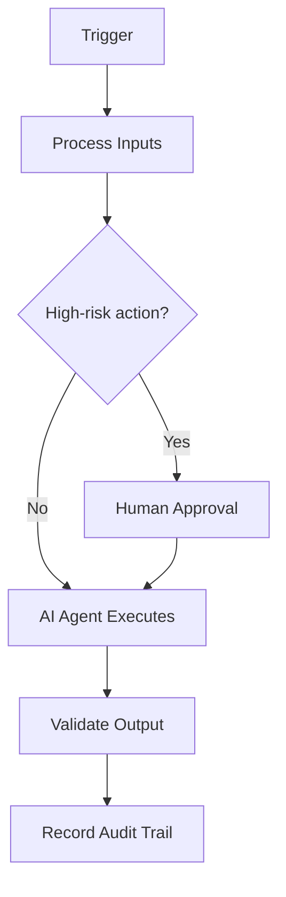

# Hallucination Investigation Playbook

> **Navigate:** [Home](../../../README.md) · [Catalogue](../../../ROOT_INDEX.md) · [Generated Index](../../README.md) · [Phase 08 Prompt](../../../01_PHASES/PHASE_08_PLAYBOOKS_MASTER_PROMPT.md)

## Executive Summary

This document defines **Hallucination Investigation Playbook** within the AIBOS Enterprise v2.0 framework (Phase 08). It inherits every root standard and is designed to be enterprise-ready, machine-readable and AI-friendly.

## Business Objective

This section (Business Objective) for **Hallucination Investigation Playbook** is defined in line with the AIBOS root standards and the governing Phase 08 master prompt. See the [repository catalogue](../../../ROOT_INDEX.md) and the [root standards](../../../00_ROOT) for related material.

## Scope

Applies across the AIBOS enterprise and is inherited by all dependent artefacts. Concerns owned elsewhere are delegated to their owning documents to avoid duplication.

## Trigger Conditions

This section (Trigger Conditions) for **Hallucination Investigation Playbook** is defined in line with the AIBOS root standards and the governing Phase 08 master prompt. See the [repository catalogue](../../../ROOT_INDEX.md) and the [root standards](../../../00_ROOT) for related material.

## Preconditions

This section (Preconditions) for **Hallucination Investigation Playbook** is defined in line with the AIBOS root standards and the governing Phase 08 master prompt. See the [repository catalogue](../../../ROOT_INDEX.md) and the [root standards](../../../00_ROOT) for related material.

## Inputs

This section (Inputs) for **Hallucination Investigation Playbook** is defined in line with the AIBOS root standards and the governing Phase 08 master prompt. See the [repository catalogue](../../../ROOT_INDEX.md) and the [root standards](../../../00_ROOT) for related material.

## Outputs

This section (Outputs) for **Hallucination Investigation Playbook** is defined in line with the AIBOS root standards and the governing Phase 08 master prompt. See the [repository catalogue](../../../ROOT_INDEX.md) and the [root standards](../../../00_ROOT) for related material.

## Roles Responsible

This section (Roles Responsible) for **Hallucination Investigation Playbook** is defined in line with the AIBOS root standards and the governing Phase 08 master prompt. See the [repository catalogue](../../../ROOT_INDEX.md) and the [root standards](../../../00_ROOT) for related material.

## AI Agents Involved

- See **[AI Agent Collaboration (Phase 11)](../../PHASE_11_AI_AGENT_COLLABORATION/README.md)** for the relevant artefacts.
- Inherited standards: [AIBOS Root Specification](../../../00_ROOT/AIBOS_ROOT_SPECIFICATION.md).
- Full catalogue: [ROOT_INDEX](../../../ROOT_INDEX.md).

## Human Approval Points

This section (Human Approval Points) for **Hallucination Investigation Playbook** is defined in line with the AIBOS root standards and the governing Phase 08 master prompt. See the [repository catalogue](../../../ROOT_INDEX.md) and the [root standards](../../../00_ROOT) for related material.

## Workflow Overview

This section (Workflow Overview) for **Hallucination Investigation Playbook** is defined in line with the AIBOS root standards and the governing Phase 08 master prompt. See the [repository catalogue](../../../ROOT_INDEX.md) and the [root standards](../../../00_ROOT) for related material.

## Mermaid Workflow Diagram

## Step-by-Step Procedure

This section (Step-by-Step Procedure) for **Hallucination Investigation Playbook** is defined in line with the AIBOS root standards and the governing Phase 08 master prompt. See the [repository catalogue](../../../ROOT_INDEX.md) and the [root standards](../../../00_ROOT) for related material.

## Decision Branches

This section (Decision Branches) for **Hallucination Investigation Playbook** is defined in line with the AIBOS root standards and the governing Phase 08 master prompt. See the [repository catalogue](../../../ROOT_INDEX.md) and the [root standards](../../../00_ROOT) for related material.

## Exception Handling

This section (Exception Handling) for **Hallucination Investigation Playbook** is defined in line with the AIBOS root standards and the governing Phase 08 master prompt. See the [repository catalogue](../../../ROOT_INDEX.md) and the [root standards](../../../00_ROOT) for related material.

## Escalation Path

This section (Escalation Path) for **Hallucination Investigation Playbook** is defined in line with the AIBOS root standards and the governing Phase 08 master prompt. See the [repository catalogue](../../../ROOT_INDEX.md) and the [root standards](../../../00_ROOT) for related material.

## Required Skills

- See **[Specialist Skills (Phase 05)](../../PHASE_05_SKILLS/README.md)** for the relevant artefacts.
- Inherited standards: [AIBOS Root Specification](../../../00_ROOT/AIBOS_ROOT_SPECIFICATION.md).
- Full catalogue: [ROOT_INDEX](../../../ROOT_INDEX.md).

## Required Rules

- See **[Enterprise Rules (Phase 06)](../../PHASE_06_RULES/README.md)** for the relevant artefacts.
- Inherited standards: [AIBOS Root Specification](../../../00_ROOT/AIBOS_ROOT_SPECIFICATION.md).
- Full catalogue: [ROOT_INDEX](../../../ROOT_INDEX.md).

## Required Checklists

- See **[Enterprise Checklists (Phase 07)](../../PHASE_07_CHECKLISTS/README.md)** for the relevant artefacts.
- Inherited standards: [AIBOS Root Specification](../../../00_ROOT/AIBOS_ROOT_SPECIFICATION.md).
- Full catalogue: [ROOT_INDEX](../../../ROOT_INDEX.md).

## Required Templates

- See **[Enterprise Templates (Phase 09)](../../PHASE_09_TEMPLATES/README.md)** for the relevant artefacts.
- Inherited standards: [AIBOS Root Specification](../../../00_ROOT/AIBOS_ROOT_SPECIFICATION.md).
- Full catalogue: [ROOT_INDEX](../../../ROOT_INDEX.md).

## Required Knowledge Articles

- See **[Enterprise Knowledge (Phase 10)](../../PHASE_10_KNOWLEDGE/README.md)** for the relevant artefacts.
- Inherited standards: [AIBOS Root Specification](../../../00_ROOT/AIBOS_ROOT_SPECIFICATION.md).
- Full catalogue: [ROOT_INDEX](../../../ROOT_INDEX.md).

## Automation Opportunities

This section (Automation Opportunities) for **Hallucination Investigation Playbook** is defined in line with the AIBOS root standards and the governing Phase 08 master prompt. See the [repository catalogue](../../../ROOT_INDEX.md) and the [root standards](../../../00_ROOT) for related material.

## Integration Points

This section (Integration Points) for **Hallucination Investigation Playbook** is defined in line with the AIBOS root standards and the governing Phase 08 master prompt. See the [repository catalogue](../../../ROOT_INDEX.md) and the [root standards](../../../00_ROOT) for related material.

## KPIs

- Coverage and completeness.
- Validation pass rate (target 95%+).
- Cycle time from draft to approval.
- Reuse rate across the enterprise.

## SLAs

- Acknowledgement within 1 business day.
- Resolution targets aligned to severity.
- Reporting on breaches and trends.

## Risks

- Scope drift over time.
- Inconsistent adoption across teams.
- Over-automation without adequate oversight.

## Best Practices

- Reuse before build.
- Automate validation.
- Keep documents atomic and cross-referenced.

## Anti-patterns

- Duplicating concepts defined elsewhere.
- Bypassing human approval for high-risk actions.
- Undocumented exceptions.

## Definition of Done

- Artefact validated and approved.
- Cross-references confirmed.
- Version history updated.

## Acceptance Criteria

- All mandatory sections are complete.
- Validation passes with no errors.
- Cross-references are valid.

## Post-Implementation Review

This section (Post-Implementation Review) for **Hallucination Investigation Playbook** is defined in line with the AIBOS root standards and the governing Phase 08 master prompt. See the [repository catalogue](../../../ROOT_INDEX.md) and the [root standards](../../../00_ROOT) for related material.

## Continuous Improvement

This section (Continuous Improvement) for **Hallucination Investigation Playbook** is defined in line with the AIBOS root standards and the governing Phase 08 master prompt. See the [repository catalogue](../../../ROOT_INDEX.md) and the [root standards](../../../00_ROOT) for related material.

## Validation Checklist

- [ ] YAML front matter is present and valid.
- [ ] All mandatory sections are complete.
- [ ] Terminology matches the AIBOS Enterprise Glossary.
- [ ] Cross-references resolve to existing documents.
- [ ] RFC 2119 keywords are used correctly.
- [ ] Security and privacy considerations are addressed.
- [ ] Version history is updated.
- [ ] No secrets or sensitive data are exposed.

## References

- [AIBOS Root Specification](../../../00_ROOT/AIBOS_ROOT_SPECIFICATION.md)
- [Enterprise Glossary](../../../00_ROOT/AIBOS_ENTERPRISE_GLOSSARY.md)
- [Document Schema](../../../00_ROOT/AIBOS_DOCUMENT_SCHEMA.md)
- [Repository Catalogue (ROOT_INDEX)](../../../ROOT_INDEX.md)
- [Phase 08 Master Prompt](../../../01_PHASES/PHASE_08_PLAYBOOKS_MASTER_PROMPT.md)

## Version History

| Version | Date | Summary |
| --- | --- | --- |
| 2.0.0 | 2026-06-26 | Initial generated artefact. |
