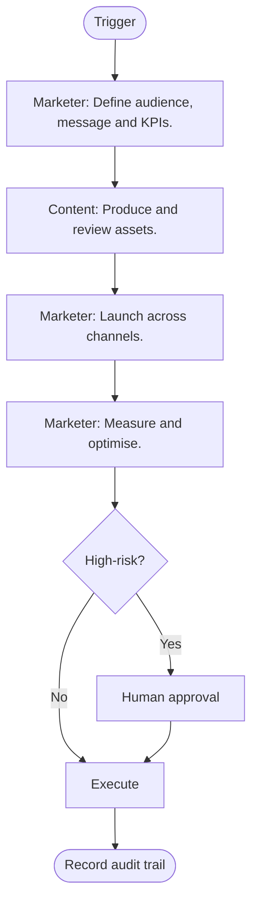

# Marketing Campaign Launch Playbook

> **Navigate:** [Home](../../../README.md) · [Catalogue](../../../ROOT_INDEX.md) · [All Playbooks](../README.md) · [Phase 08 Prompt](../../../01_PHASES/PHASE_08_PLAYBOOKS_MASTER_PROMPT.md)

**Playbook ID:** PLAY-000036  •  **Category:** Business

## Executive Summary

A repeatable, automatable workflow for **Marketing Campaign Launch**. Generating awareness, demand and reputation for the product through content, channels and campaigns — including AI search visibility. It is executable by human teams and AI agents with clear human-approval points.

## Business Objective

Make marketing campaign launch consistent, fast, safe and auditable across the enterprise.

## Scope

Covers the end-to-end marketing campaign launch workflow. Out-of-scope concerns are delegated to their own playbooks.

## Trigger Conditions

- Product launch
- Campaign cycle
- Demand goal

## Preconditions

- Required inputs, access and approvals are available.
- Relevant rules and checklists are known.

## Inputs

- The request/context that triggered the workflow.
- Relevant data, artefacts and configuration.

## Outputs

- The completed outcome of the workflow.
- Evidence, audit trail and any follow-up actions.

## Roles Responsible

- Content
- Marketer

## AI Agents Involved

- Task agent(s) that execute eligible steps.
- Reviewer/evaluator agent that checks outputs.
- Orchestrator that coordinates and escalates.

## Human Approval Points

- Before any high-risk or irreversible action.
- At the final approval/sign-off step.

## Workflow Overview

The workflow proceeds through 4 main steps with a decision point that routes high-risk actions to human approval.

## Mermaid Workflow Diagram

## Step-by-Step Procedure

| Step | Actor | Action |
| --- | --- | --- |
| 1 | Marketer | Define audience, message and KPIs. |
| 2 | Content | Produce and review assets. |
| 3 | Marketer | Launch across channels. |
| 4 | Marketer | Measure and optimise. |

## Decision Branches

- If the action is high-risk or irreversible -> require human approval.
- If validation fails -> remediate and repeat the step.
- If blocked -> follow the escalation path.

## Exception Handling

- Capture the error and context.
- Apply the documented fallback or safe-stop.
- Open an incident if customer impact is possible.

## Escalation Path

Owner -> domain lead -> Governance Division, with severity-based timelines.

## Required Skills

Executed by holders of the relevant [Specialist Skills](../../PHASE_05_SKILLS/README.md).

## Required Rules

Must comply with the [Enterprise Rules](../../PHASE_06_RULES/README.md).

## Required Checklists

Validated using the [Enterprise Checklists](../../PHASE_07_CHECKLISTS/README.md).

## Required Templates

Uses the [Enterprise Templates](../../PHASE_09_TEMPLATES/README.md).

## Required Knowledge Articles

Background in the [Enterprise Knowledge base](../../PHASE_10_KNOWLEDGE/README.md).

## Automation Opportunities

- Automate repeatable steps and validations in CI/CD or workflows.
- Use AI agents for drafting, triage and checks.
- Auto-collect evidence and update tracking systems.

## Integration Points

- GitHub / GitLab (code, PRs, actions).
- Jira / Linear (tracking).
- Slack / Teams (notifications).
- Vercel / cloud (deploy).
- n8n / Make (orchestration).

## KPIs

- Qualified leads
- CAC
- Conversion
- Share of voice

## SLAs

- Acknowledge triggers within 1 business day.
- Complete standard runs within the agreed target time.
- Resolve exceptions per severity SLA.

## Risks

- Inaccurate or non-compliant marketing harms trust and law.

## Best Practices

- Define KPIs first.
- Measure attribution.
- Stay compliant.

## Anti-patterns

- Vanity metrics only.
- Unsubstantiated claims.
- Ignoring privacy.

## Definition of Done

- Outcome achieved and validated.
- Audit trail recorded.
- Follow-up actions tracked.

## Acceptance Criteria

- All steps completed or consciously skipped with reason.
- Required checklist passed.
- Approvals obtained.

## Post-Implementation Review

Review outcomes against objectives; capture lessons and improvement actions.

## Continuous Improvement

Feed metrics and lessons back into this playbook; update on a regular cadence.

## Validation Checklist

- [ ] Trigger and preconditions verified.
- [ ] Steps executed in order with evidence.
- [ ] Human approval obtained for high-risk actions.
- [ ] Required checklist passed.
- [ ] Audit trail recorded.
- [ ] Cross-references resolve.

## References

- [AIBOS Root Specification](../../../00_ROOT/AIBOS_ROOT_SPECIFICATION.md)
- [Repository Catalogue (ROOT_INDEX)](../../../ROOT_INDEX.md)
- [Phase 08 Master Prompt](../../../01_PHASES/PHASE_08_PLAYBOOKS_MASTER_PROMPT.md)

## Version History

| Version | Date | Summary |
| --- | --- | --- |
| 2.0.0 | 2026-06-26 | Complete, ready-to-use playbook. |
