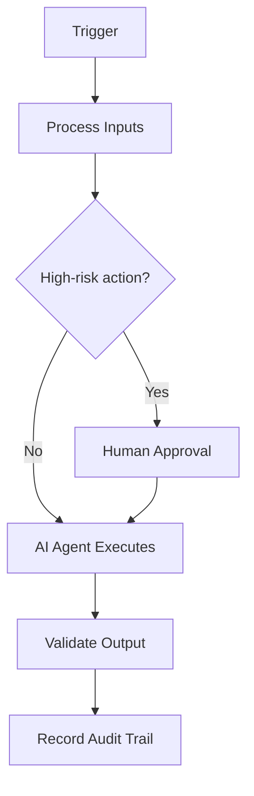

# Rollback Playbook

## Executive Summary

This document defines **Rollback Playbook** within the AIBOS Enterprise v2.0 framework (Phase 08). It inherits every root standard and is designed to be enterprise-ready, machine-readable and AI-friendly.

## Business Objective

This section (Business Objective) for **Rollback Playbook** is defined in line with the AIBOS root standards and the governing Phase 08 master prompt. See `ROOT_INDEX.md` for related artefacts and `00_ROOT/` for the inherited standards.

## Scope

Applies across the AIBOS enterprise and is inherited by all dependent artefacts. Concerns owned elsewhere are delegated to their owning documents to avoid duplication.

## Trigger Conditions

This section (Trigger Conditions) for **Rollback Playbook** is defined in line with the AIBOS root standards and the governing Phase 08 master prompt. See `ROOT_INDEX.md` for related artefacts and `00_ROOT/` for the inherited standards.

## Preconditions

This section (Preconditions) for **Rollback Playbook** is defined in line with the AIBOS root standards and the governing Phase 08 master prompt. See `ROOT_INDEX.md` for related artefacts and `00_ROOT/` for the inherited standards.

## Inputs

This section (Inputs) for **Rollback Playbook** is defined in line with the AIBOS root standards and the governing Phase 08 master prompt. See `ROOT_INDEX.md` for related artefacts and `00_ROOT/` for the inherited standards.

## Outputs

This section (Outputs) for **Rollback Playbook** is defined in line with the AIBOS root standards and the governing Phase 08 master prompt. See `ROOT_INDEX.md` for related artefacts and `00_ROOT/` for the inherited standards.

## Roles Responsible

This section (Roles Responsible) for **Rollback Playbook** is defined in line with the AIBOS root standards and the governing Phase 08 master prompt. See `ROOT_INDEX.md` for related artefacts and `00_ROOT/` for the inherited standards.

## AI Agents Involved

This section (AI Agents Involved) for **Rollback Playbook** is defined in line with the AIBOS root standards and the governing Phase 08 master prompt. See `ROOT_INDEX.md` for related artefacts and `00_ROOT/` for the inherited standards.

## Human Approval Points

This section (Human Approval Points) for **Rollback Playbook** is defined in line with the AIBOS root standards and the governing Phase 08 master prompt. See `ROOT_INDEX.md` for related artefacts and `00_ROOT/` for the inherited standards.

## Workflow Overview

This section (Workflow Overview) for **Rollback Playbook** is defined in line with the AIBOS root standards and the governing Phase 08 master prompt. See `ROOT_INDEX.md` for related artefacts and `00_ROOT/` for the inherited standards.

## Mermaid Workflow Diagram

## Step-by-Step Procedure

This section (Step-by-Step Procedure) for **Rollback Playbook** is defined in line with the AIBOS root standards and the governing Phase 08 master prompt. See `ROOT_INDEX.md` for related artefacts and `00_ROOT/` for the inherited standards.

## Decision Branches

This section (Decision Branches) for **Rollback Playbook** is defined in line with the AIBOS root standards and the governing Phase 08 master prompt. See `ROOT_INDEX.md` for related artefacts and `00_ROOT/` for the inherited standards.

## Exception Handling

This section (Exception Handling) for **Rollback Playbook** is defined in line with the AIBOS root standards and the governing Phase 08 master prompt. See `ROOT_INDEX.md` for related artefacts and `00_ROOT/` for the inherited standards.

## Escalation Path

This section (Escalation Path) for **Rollback Playbook** is defined in line with the AIBOS root standards and the governing Phase 08 master prompt. See `ROOT_INDEX.md` for related artefacts and `00_ROOT/` for the inherited standards.

## Required Skills

- Inherits all root standards under `00_ROOT/`.
- Cross-references the relevant Phase artefacts under `02_ARTEFACTS/`.
- See `ROOT_INDEX.md` for the full catalogue.

## Required Rules

- Inherits all root standards under `00_ROOT/`.
- Cross-references the relevant Phase artefacts under `02_ARTEFACTS/`.
- See `ROOT_INDEX.md` for the full catalogue.

## Required Checklists

- Inherits all root standards under `00_ROOT/`.
- Cross-references the relevant Phase artefacts under `02_ARTEFACTS/`.
- See `ROOT_INDEX.md` for the full catalogue.

## Required Templates

- Inherits all root standards under `00_ROOT/`.
- Cross-references the relevant Phase artefacts under `02_ARTEFACTS/`.
- See `ROOT_INDEX.md` for the full catalogue.

## Required Knowledge Articles

- Inherits all root standards under `00_ROOT/`.
- Cross-references the relevant Phase artefacts under `02_ARTEFACTS/`.
- See `ROOT_INDEX.md` for the full catalogue.

## Automation Opportunities

This section (Automation Opportunities) for **Rollback Playbook** is defined in line with the AIBOS root standards and the governing Phase 08 master prompt. See `ROOT_INDEX.md` for related artefacts and `00_ROOT/` for the inherited standards.

## Integration Points

This section (Integration Points) for **Rollback Playbook** is defined in line with the AIBOS root standards and the governing Phase 08 master prompt. See `ROOT_INDEX.md` for related artefacts and `00_ROOT/` for the inherited standards.

## KPIs

- Coverage and completeness of the artefact.
- Validation pass rate (target 95%+).
- Cycle time from draft to approval.
- Reuse rate across the enterprise.

## SLAs

- Coverage and completeness of the artefact.
- Validation pass rate (target 95%+).
- Cycle time from draft to approval.
- Reuse rate across the enterprise.

## Risks

- Scope drift over time.
- Inconsistent adoption across teams.
- Over-automation without adequate oversight.

## Best Practices

- Reuse before build.
- Automate validation.
- Keep documents atomic and cross-referenced.

## Anti-patterns

- Duplicating concepts defined elsewhere.
- Bypassing human approval for high-risk actions.
- Undocumented exceptions.

## Definition of Done

- Artefact validated and approved.
- Cross-references confirmed.
- Version history updated.

## Acceptance Criteria

- All mandatory sections are complete.
- Validation passes with no errors.
- Cross-references are valid.

## Post-Implementation Review

This section (Post-Implementation Review) for **Rollback Playbook** is defined in line with the AIBOS root standards and the governing Phase 08 master prompt. See `ROOT_INDEX.md` for related artefacts and `00_ROOT/` for the inherited standards.

## Continuous Improvement

This section (Continuous Improvement) for **Rollback Playbook** is defined in line with the AIBOS root standards and the governing Phase 08 master prompt. See `ROOT_INDEX.md` for related artefacts and `00_ROOT/` for the inherited standards.

## Validation Checklist

- [ ] YAML front matter is present and valid.
- [ ] All mandatory sections are complete.
- [ ] Terminology matches the AIBOS Enterprise Glossary.
- [ ] Cross-references resolve to existing documents.
- [ ] RFC 2119 keywords are used correctly.
- [ ] Security and privacy considerations are addressed.
- [ ] Version history is updated.
- [ ] No secrets or sensitive data are exposed.

## References

This section (References) for **Rollback Playbook** is defined in line with the AIBOS root standards and the governing Phase 08 master prompt. See `ROOT_INDEX.md` for related artefacts and `00_ROOT/` for the inherited standards.

## Version History

| Version | Date | Summary |
| --- | --- | --- |
| 2.0.0 | 2026-06-26 | Initial generated artefact. |
