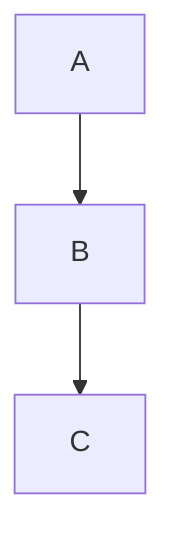

# Technical Design Template

> **Navigate:** [Home](../../../README.md) · [Catalogue](../../../ROOT_INDEX.md) · [All Templates](../README.md) · [Phase 09 Prompt](../../../01_PHASES/PHASE_09_TEMPLATES_MASTER_PROMPT.md)

**Template ID:** TEMP-000014  •  **Category:** Engineering

## Purpose

Describe how a feature/system will be built.

## When to Use

Before implementation of non-trivial work.

## Audience

Engineers and reviewers.

## Inputs Required

- Design title

## Outputs Produced

A completed **Technical Design Template** ready for review and use.

## Required Metadata

Every instance MUST carry: `id`, `title`, `owner`, `version`, `status`, `created`, `updated`.

## Placeholder Definitions

| Placeholder | Meaning |
| --- | --- |
| `{{title}}` | Design title |
| `{{date}}` | ISO date the document is created (YYYY-MM-DD). |

## Template

Copy the block below and replace every `{{placeholder}}` with real content.

````markdown
# Technical Design: {{title}}

## Goals & Non-goals
- ...

## Proposed Design
- Components, data flow, APIs.

## Diagram


## Alternatives
- ...

## Security, Privacy, Performance
- ...

## Testing & Rollout
- ...
````

## Naming Convention

`NN_TECHNICAL_DESIGN.md` (zero-padded order prefix, UPPER_SNAKE_CASE).

## Folder Convention

Master template lives under `02_ARTEFACTS/PHASE_09_TEMPLATES/Engineering/`. Copy instances into the relevant project/repository location.

## Required Skills

See the [Specialist Skills](../../PHASE_05_SKILLS/README.md) relevant to this artefact.

## Required Rules

Comply with the [Enterprise Rules](../../PHASE_06_RULES/README.md).

## Required Checklists

Validate with the [Enterprise Checklists](../../PHASE_07_CHECKLISTS/README.md).

## Required Playbooks

Produced within the [Enterprise Playbooks](../../PHASE_08_PLAYBOOKS/README.md).

## Required Knowledge Articles

Background in the [Enterprise Knowledge base](../../PHASE_10_KNOWLEDGE/README.md).

## Validation Rules

- [ ] All `{{placeholders}}` are replaced (none remain).
- [ ] Required metadata is present and valid.
- [ ] No secrets or sensitive data are included.
- [ ] Cross-references resolve.
- [ ] Content follows the AIBOS style guide.

## Quality Criteria

- Consistent and reusable across teams.
- Modular and easy to customise.
- Machine-readable and automation-ready.
- Version-controlled and reviewed.

## Example Completed Template

Fill each placeholder with concrete values. For example, replace `{{title}}` with a real value and complete each section with project-specific detail.

## JSON Schema

```json
{
  "$schema": "https://json-schema.org/draft/2020-12/schema",
  "type": "object",
  "required": ["id", "title", "version"],
  "properties": {
    "id": { "type": "string" },
    "title": { "type": "string" },
    "version": { "type": "string" }
  }
}
```

## YAML Schema

```yaml
id: DOC-000000
title: Example
owner: Owning Team
version: 1.0.0
status: Draft
```

## AI Prompt Usage Guidance

- Prompt an AI agent: "Using the Technical Design Template below, produce a completed version for <context>; replace every placeholder and keep the structure."
- Provide the source inputs (notes, tickets, data) as context.
- Ask the agent to flag any placeholder it cannot fill confidently.
- Always have a human review AI-completed instances before use.

## Automation Compatibility

- GitHub / GitHub Actions (scaffold and validate).
- Cursor, Claude, GPT, Gemini (AI-assisted completion).
- n8n / Make (workflow generation).
- MCP tools and CI/CD pipelines.

## Version History

| Version | Date | Summary |
| --- | --- | --- |
| 2.0.0 | 2026-06-26 | Complete, ready-to-use template. |
