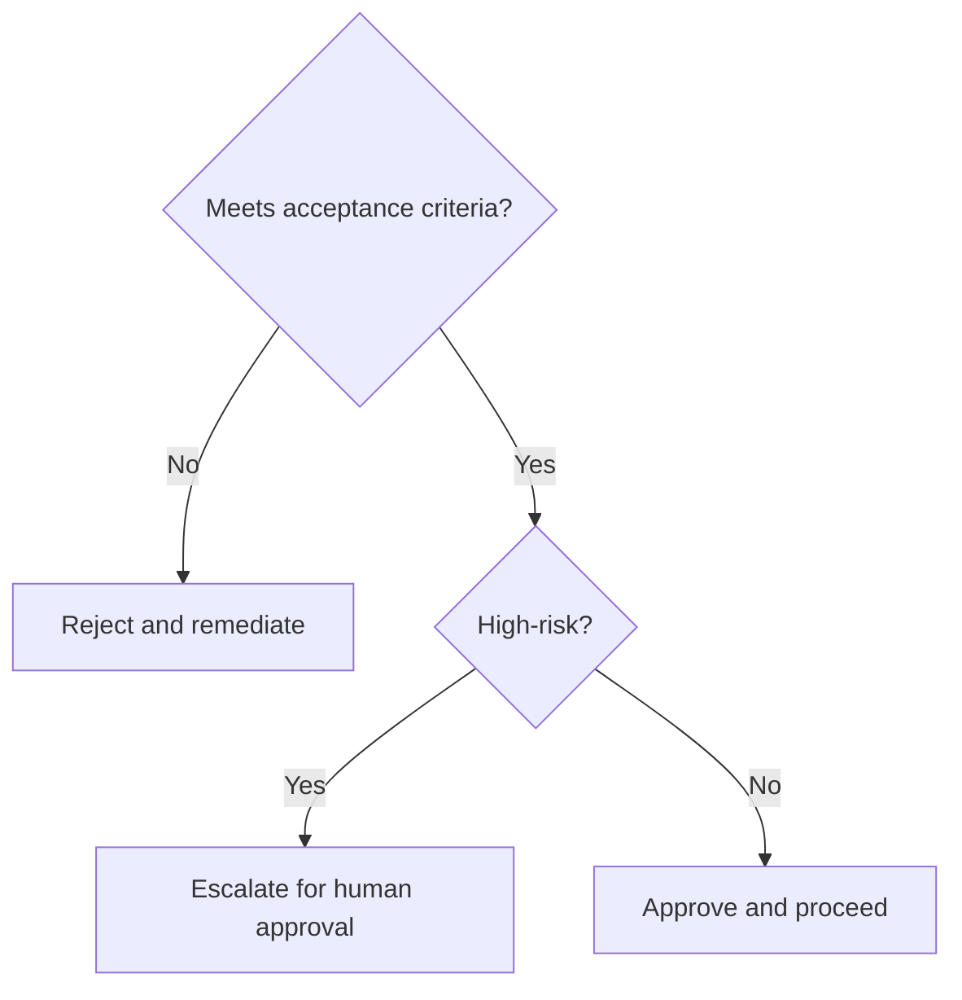

# Customer Success Knowledge Article

> **Navigate:** [Home](../../../README.md) · [Catalogue](../../../ROOT_INDEX.md) · [Generated Index](../../README.md) · [Phase 10 Prompt](../../../01_PHASES/PHASE_10_KNOWLEDGE_MASTER_PROMPT.md)

## Executive Summary

This document defines **Customer Success Knowledge Article** within the AIBOS Enterprise v2.0 framework (Phase 10). It inherits every root standard and is designed to be enterprise-ready, machine-readable and AI-friendly.

## Purpose

To establish the authoritative, reusable definition of Customer Success Knowledge Article so that human teams and AI agents operate consistently, safely and with measurable business value.

## Scope

Applies across the AIBOS enterprise and is inherited by all dependent artefacts. Concerns owned elsewhere are delegated to their owning documents to avoid duplication.

## Core Concepts

This section (Core Concepts) for **Customer Success Knowledge Article** is defined in line with the AIBOS root standards and the governing Phase 10 master prompt. See the [repository catalogue](../../../ROOT_INDEX.md) and the [root standards](../../../00_ROOT) for related material.

## Definitions

- Canonical terms are defined in the [Enterprise Glossary](../../../00_ROOT/AIBOS_ENTERPRISE_GLOSSARY.md).
- No terminology is redefined within this document.

## Business Context

This section (Business Context) for **Customer Success Knowledge Article** is defined in line with the AIBOS root standards and the governing Phase 10 master prompt. See the [repository catalogue](../../../ROOT_INDEX.md) and the [root standards](../../../00_ROOT) for related material.

## Technical Context

This section (Technical Context) for **Customer Success Knowledge Article** is defined in line with the AIBOS root standards and the governing Phase 10 master prompt. See the [repository catalogue](../../../ROOT_INDEX.md) and the [root standards](../../../00_ROOT) for related material.

## Best Practices

- Reuse before build.
- Automate validation.
- Keep documents atomic and cross-referenced.

## Anti-patterns

- Duplicating concepts defined elsewhere.
- Bypassing human approval for high-risk actions.
- Undocumented exceptions.

## Design Patterns

This section (Design Patterns) for **Customer Success Knowledge Article** is defined in line with the AIBOS root standards and the governing Phase 10 master prompt. See the [repository catalogue](../../../ROOT_INDEX.md) and the [root standards](../../../00_ROOT) for related material.

## Examples

```yaml
# Example for: Customer Success Knowledge Article
name: example
version: 2.0.0
status: draft
```

## FAQs

**Q: How does this artefact relate to the AIBOS standards?**

A: It inherits and must not contradict the root standards.

**Q: Who owns Customer Success Knowledge Article?**

A: Chief Knowledge Architect.

## Decision Tree



## Learning Path

This section (Learning Path) for **Customer Success Knowledge Article** is defined in line with the AIBOS root standards and the governing Phase 10 master prompt. See the [repository catalogue](../../../ROOT_INDEX.md) and the [root standards](../../../00_ROOT) for related material.

## Prerequisites

This section (Prerequisites) for **Customer Success Knowledge Article** is defined in line with the AIBOS root standards and the governing Phase 10 master prompt. See the [repository catalogue](../../../ROOT_INDEX.md) and the [root standards](../../../00_ROOT) for related material.

## Related Skills

- See **[Specialist Skills (Phase 05)](../../PHASE_05_SKILLS/README.md)** for the relevant artefacts.
- Inherited standards: [AIBOS Root Specification](../../../00_ROOT/AIBOS_ROOT_SPECIFICATION.md).
- Full catalogue: [ROOT_INDEX](../../../ROOT_INDEX.md).

## Related Rules

- See **[Enterprise Rules (Phase 06)](../../PHASE_06_RULES/README.md)** for the relevant artefacts.
- Inherited standards: [AIBOS Root Specification](../../../00_ROOT/AIBOS_ROOT_SPECIFICATION.md).
- Full catalogue: [ROOT_INDEX](../../../ROOT_INDEX.md).

## Related Checklists

- See **[Enterprise Checklists (Phase 07)](../../PHASE_07_CHECKLISTS/README.md)** for the relevant artefacts.
- Inherited standards: [AIBOS Root Specification](../../../00_ROOT/AIBOS_ROOT_SPECIFICATION.md).
- Full catalogue: [ROOT_INDEX](../../../ROOT_INDEX.md).

## Related Playbooks

- See **[Enterprise Playbooks (Phase 08)](../../PHASE_08_PLAYBOOKS/README.md)** for the relevant artefacts.
- Inherited standards: [AIBOS Root Specification](../../../00_ROOT/AIBOS_ROOT_SPECIFICATION.md).
- Full catalogue: [ROOT_INDEX](../../../ROOT_INDEX.md).

## Related Templates

- See **[Enterprise Templates (Phase 09)](../../PHASE_09_TEMPLATES/README.md)** for the relevant artefacts.
- Inherited standards: [AIBOS Root Specification](../../../00_ROOT/AIBOS_ROOT_SPECIFICATION.md).
- Full catalogue: [ROOT_INDEX](../../../ROOT_INDEX.md).

## Related Knowledge

- See **[Enterprise Knowledge (Phase 10)](../README.md)** for the relevant artefacts.
- Inherited standards: [AIBOS Root Specification](../../../00_ROOT/AIBOS_ROOT_SPECIFICATION.md).
- Full catalogue: [ROOT_INDEX](../../../ROOT_INDEX.md).

## Department Ownership

This section (Department Ownership) for **Customer Success Knowledge Article** is defined in line with the AIBOS root standards and the governing Phase 10 master prompt. See the [repository catalogue](../../../ROOT_INDEX.md) and the [root standards](../../../00_ROOT) for related material.

## Division Ownership

This section (Division Ownership) for **Customer Success Knowledge Article** is defined in line with the AIBOS root standards and the governing Phase 10 master prompt. See the [repository catalogue](../../../ROOT_INDEX.md) and the [root standards](../../../00_ROOT) for related material.

## External Standards

| Standard | Application |
| --- | --- |
| ISO 42001 | AI management system alignment. |
| ISO 27001 | Information security controls. |
| NIST AI RMF | AI risk management. |
| OWASP LLM Top 10 | LLM threat mitigation. |

## References

- [AIBOS Root Specification](../../../00_ROOT/AIBOS_ROOT_SPECIFICATION.md)
- [Enterprise Glossary](../../../00_ROOT/AIBOS_ENTERPRISE_GLOSSARY.md)
- [Document Schema](../../../00_ROOT/AIBOS_DOCUMENT_SCHEMA.md)
- [Repository Catalogue (ROOT_INDEX)](../../../ROOT_INDEX.md)
- [Phase 10 Master Prompt](../../../01_PHASES/PHASE_10_KNOWLEDGE_MASTER_PROMPT.md)

## AI Retrieval Metadata

This section (AI Retrieval Metadata) for **Customer Success Knowledge Article** is defined in line with the AIBOS root standards and the governing Phase 10 master prompt. See the [repository catalogue](../../../ROOT_INDEX.md) and the [root standards](../../../00_ROOT) for related material.

## Suggested Chunk Boundaries

This section (Suggested Chunk Boundaries) for **Customer Success Knowledge Article** is defined in line with the AIBOS root standards and the governing Phase 10 master prompt. See the [repository catalogue](../../../ROOT_INDEX.md) and the [root standards](../../../00_ROOT) for related material.

## Suggested Embedding Keywords

This section (Suggested Embedding Keywords) for **Customer Success Knowledge Article** is defined in line with the AIBOS root standards and the governing Phase 10 master prompt. See the [repository catalogue](../../../ROOT_INDEX.md) and the [root standards](../../../00_ROOT) for related material.

## Version History

| Version | Date | Summary |
| --- | --- | --- |
| 2.0.0 | 2026-06-26 | Initial generated artefact. |
