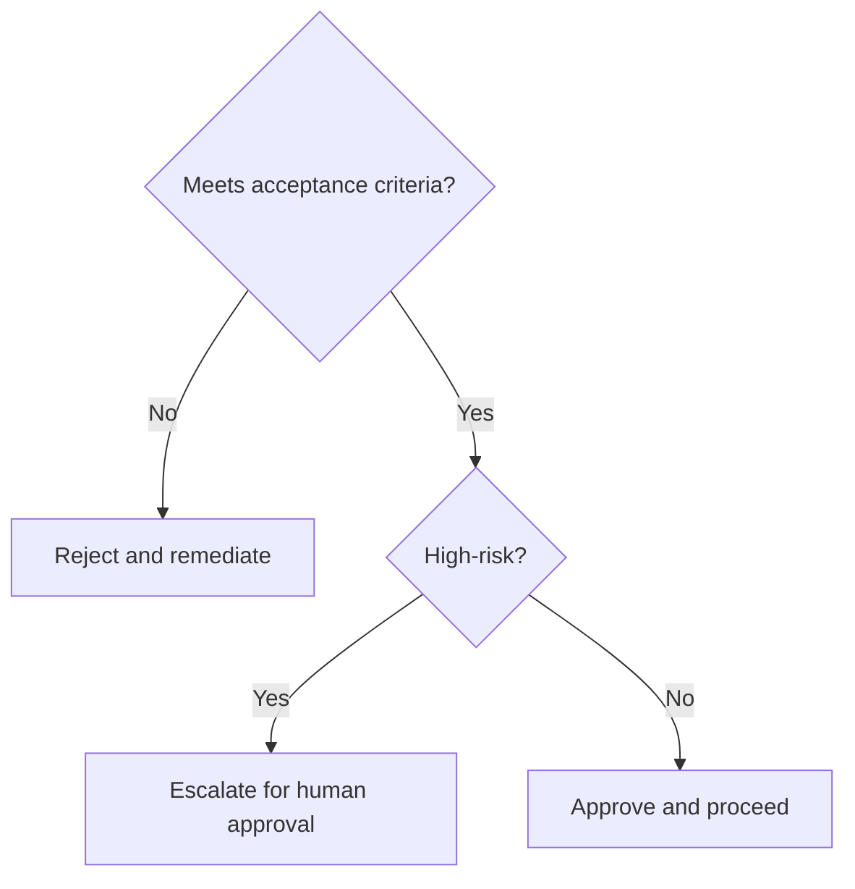

# Retention Knowledge Article

## Executive Summary

This document defines **Retention Knowledge Article** within the AIBOS Enterprise v2.0 framework (Phase 10). It inherits every root standard and is designed to be enterprise-ready, machine-readable and AI-friendly.

## Purpose

To establish the authoritative, reusable definition of Retention Knowledge Article so that human teams and AI agents operate consistently, safely and with measurable business value.

## Scope

Applies across the AIBOS enterprise and is inherited by all dependent artefacts. Concerns owned elsewhere are delegated to their owning documents to avoid duplication.

## Core Concepts

This section (Core Concepts) for **Retention Knowledge Article** is defined in line with the AIBOS root standards and the governing Phase 10 master prompt. See `ROOT_INDEX.md` for related artefacts and `00_ROOT/` for the inherited standards.

## Definitions

- Refer to `00_ROOT/AIBOS_ENTERPRISE_GLOSSARY.md` for canonical terms.
- No terminology is redefined within this document.

## Business Context

This section (Business Context) for **Retention Knowledge Article** is defined in line with the AIBOS root standards and the governing Phase 10 master prompt. See `ROOT_INDEX.md` for related artefacts and `00_ROOT/` for the inherited standards.

## Technical Context

This section (Technical Context) for **Retention Knowledge Article** is defined in line with the AIBOS root standards and the governing Phase 10 master prompt. See `ROOT_INDEX.md` for related artefacts and `00_ROOT/` for the inherited standards.

## Best Practices

- Reuse before build.
- Automate validation.
- Keep documents atomic and cross-referenced.

## Anti-patterns

- Duplicating concepts defined elsewhere.
- Bypassing human approval for high-risk actions.
- Undocumented exceptions.

## Design Patterns

This section (Design Patterns) for **Retention Knowledge Article** is defined in line with the AIBOS root standards and the governing Phase 10 master prompt. See `ROOT_INDEX.md` for related artefacts and `00_ROOT/` for the inherited standards.

## Examples

```yaml
# Example for: Retention Knowledge Article
name: example
version: 2.0.0
status: draft
```

## FAQs

**Q: How does this artefact relate to the AIBOS standards?**

A: It inherits and must not contradict the root standards.

**Q: Who owns Retention Knowledge Article?**

A: Chief Knowledge Architect.

## Decision Tree



## Learning Path

This section (Learning Path) for **Retention Knowledge Article** is defined in line with the AIBOS root standards and the governing Phase 10 master prompt. See `ROOT_INDEX.md` for related artefacts and `00_ROOT/` for the inherited standards.

## Prerequisites

This section (Prerequisites) for **Retention Knowledge Article** is defined in line with the AIBOS root standards and the governing Phase 10 master prompt. See `ROOT_INDEX.md` for related artefacts and `00_ROOT/` for the inherited standards.

## Related Skills

- Inherits all root standards under `00_ROOT/`.
- Cross-references the relevant Phase artefacts under `02_ARTEFACTS/`.
- See `ROOT_INDEX.md` for the full catalogue.

## Related Rules

- Inherits all root standards under `00_ROOT/`.
- Cross-references the relevant Phase artefacts under `02_ARTEFACTS/`.
- See `ROOT_INDEX.md` for the full catalogue.

## Related Checklists

- Inherits all root standards under `00_ROOT/`.
- Cross-references the relevant Phase artefacts under `02_ARTEFACTS/`.
- See `ROOT_INDEX.md` for the full catalogue.

## Related Playbooks

- Inherits all root standards under `00_ROOT/`.
- Cross-references the relevant Phase artefacts under `02_ARTEFACTS/`.
- See `ROOT_INDEX.md` for the full catalogue.

## Related Templates

- Inherits all root standards under `00_ROOT/`.
- Cross-references the relevant Phase artefacts under `02_ARTEFACTS/`.
- See `ROOT_INDEX.md` for the full catalogue.

## Related Knowledge

- Inherits all root standards under `00_ROOT/`.
- Cross-references the relevant Phase artefacts under `02_ARTEFACTS/`.
- See `ROOT_INDEX.md` for the full catalogue.

## Department Ownership

This section (Department Ownership) for **Retention Knowledge Article** is defined in line with the AIBOS root standards and the governing Phase 10 master prompt. See `ROOT_INDEX.md` for related artefacts and `00_ROOT/` for the inherited standards.

## Division Ownership

This section (Division Ownership) for **Retention Knowledge Article** is defined in line with the AIBOS root standards and the governing Phase 10 master prompt. See `ROOT_INDEX.md` for related artefacts and `00_ROOT/` for the inherited standards.

## External Standards

| Standard | Application |
| --- | --- |
| ISO 42001 | AI management system alignment. |
| ISO 27001 | Information security controls. |
| NIST AI RMF | AI risk management. |
| OWASP LLM Top 10 | LLM threat mitigation. |

## References

This section (References) for **Retention Knowledge Article** is defined in line with the AIBOS root standards and the governing Phase 10 master prompt. See `ROOT_INDEX.md` for related artefacts and `00_ROOT/` for the inherited standards.

## AI Retrieval Metadata

This section (AI Retrieval Metadata) for **Retention Knowledge Article** is defined in line with the AIBOS root standards and the governing Phase 10 master prompt. See `ROOT_INDEX.md` for related artefacts and `00_ROOT/` for the inherited standards.

## Suggested Chunk Boundaries

This section (Suggested Chunk Boundaries) for **Retention Knowledge Article** is defined in line with the AIBOS root standards and the governing Phase 10 master prompt. See `ROOT_INDEX.md` for related artefacts and `00_ROOT/` for the inherited standards.

## Suggested Embedding Keywords

This section (Suggested Embedding Keywords) for **Retention Knowledge Article** is defined in line with the AIBOS root standards and the governing Phase 10 master prompt. See `ROOT_INDEX.md` for related artefacts and `00_ROOT/` for the inherited standards.

## Version History

| Version | Date | Summary |
| --- | --- | --- |
| 2.0.0 | 2026-06-26 | Initial generated artefact. |
