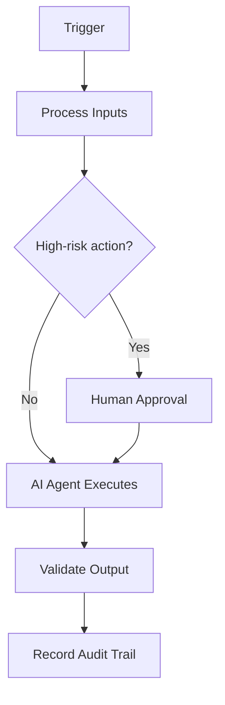

# Automation Strategy

> **Navigate:** [Home](../../../README.md) · [Catalogue](../../../ROOT_INDEX.md) · [Generated Index](../../README.md) · [Phase 12 Prompt](../../../01_PHASES/PHASE_12_ENTERPRISE_AUTOMATION_CONTINUOUS_IMPROVEMENT_MASTER_PROMPT.md)

## Executive Summary

This document defines **Automation Strategy** within the AIBOS Enterprise v2.0 framework (Phase 12). It inherits every root standard and is designed to be enterprise-ready, machine-readable and AI-friendly.

## Purpose

To establish the authoritative, reusable definition of Automation Strategy so that human teams and AI agents operate consistently, safely and with measurable business value.

## Scope

Applies across the AIBOS enterprise and is inherited by all dependent artefacts. Concerns owned elsewhere are delegated to their owning documents to avoid duplication.

## Business Value

Reduced duplication, faster safe delivery, improved compliance posture and scalable AI augmentation.

## Trigger Events

This section (Trigger Events) for **Automation Strategy** is defined in line with the AIBOS root standards and the governing Phase 12 master prompt. See the [repository catalogue](../../../ROOT_INDEX.md) and the [root standards](../../../00_ROOT) for related material.

## Inputs

This section (Inputs) for **Automation Strategy** is defined in line with the AIBOS root standards and the governing Phase 12 master prompt. See the [repository catalogue](../../../ROOT_INDEX.md) and the [root standards](../../../00_ROOT) for related material.

## Outputs

This section (Outputs) for **Automation Strategy** is defined in line with the AIBOS root standards and the governing Phase 12 master prompt. See the [repository catalogue](../../../ROOT_INDEX.md) and the [root standards](../../../00_ROOT) for related material.

## Workflow Description

This section (Workflow Description) for **Automation Strategy** is defined in line with the AIBOS root standards and the governing Phase 12 master prompt. See the [repository catalogue](../../../ROOT_INDEX.md) and the [root standards](../../../00_ROOT) for related material.

## Mermaid Diagram

## AI Agents Involved

- See **[AI Agent Collaboration (Phase 11)](../../PHASE_11_AI_AGENT_COLLABORATION/README.md)** for the relevant artefacts.
- Inherited standards: [AIBOS Root Specification](../../../00_ROOT/AIBOS_ROOT_SPECIFICATION.md).
- Full catalogue: [ROOT_INDEX](../../../ROOT_INDEX.md).

## Human Approval Points

This section (Human Approval Points) for **Automation Strategy** is defined in line with the AIBOS root standards and the governing Phase 12 master prompt. See the [repository catalogue](../../../ROOT_INDEX.md) and the [root standards](../../../00_ROOT) for related material.

## Automation Opportunities

This section (Automation Opportunities) for **Automation Strategy** is defined in line with the AIBOS root standards and the governing Phase 12 master prompt. See the [repository catalogue](../../../ROOT_INDEX.md) and the [root standards](../../../00_ROOT) for related material.

## Tool Integrations

This section (Tool Integrations) for **Automation Strategy** is defined in line with the AIBOS root standards and the governing Phase 12 master prompt. See the [repository catalogue](../../../ROOT_INDEX.md) and the [root standards](../../../00_ROOT) for related material.

## Required Skills

- See **[Specialist Skills (Phase 05)](../../PHASE_05_SKILLS/README.md)** for the relevant artefacts.
- Inherited standards: [AIBOS Root Specification](../../../00_ROOT/AIBOS_ROOT_SPECIFICATION.md).
- Full catalogue: [ROOT_INDEX](../../../ROOT_INDEX.md).

## Governing Rules

- See **[Enterprise Rules (Phase 06)](../../PHASE_06_RULES/README.md)** for the relevant artefacts.
- Inherited standards: [AIBOS Root Specification](../../../00_ROOT/AIBOS_ROOT_SPECIFICATION.md).
- Full catalogue: [ROOT_INDEX](../../../ROOT_INDEX.md).

## Required Checklists

- See **[Enterprise Checklists (Phase 07)](../../PHASE_07_CHECKLISTS/README.md)** for the relevant artefacts.
- Inherited standards: [AIBOS Root Specification](../../../00_ROOT/AIBOS_ROOT_SPECIFICATION.md).
- Full catalogue: [ROOT_INDEX](../../../ROOT_INDEX.md).

## Supporting Playbooks

- See **[Enterprise Playbooks (Phase 08)](../../PHASE_08_PLAYBOOKS/README.md)** for the relevant artefacts.
- Inherited standards: [AIBOS Root Specification](../../../00_ROOT/AIBOS_ROOT_SPECIFICATION.md).
- Full catalogue: [ROOT_INDEX](../../../ROOT_INDEX.md).

## Required Templates

- See **[Enterprise Templates (Phase 09)](../../PHASE_09_TEMPLATES/README.md)** for the relevant artefacts.
- Inherited standards: [AIBOS Root Specification](../../../00_ROOT/AIBOS_ROOT_SPECIFICATION.md).
- Full catalogue: [ROOT_INDEX](../../../ROOT_INDEX.md).

## Knowledge Dependencies

- See **[Enterprise Knowledge (Phase 10)](../../PHASE_10_KNOWLEDGE/README.md)** for the relevant artefacts.
- Inherited standards: [AIBOS Root Specification](../../../00_ROOT/AIBOS_ROOT_SPECIFICATION.md).
- Full catalogue: [ROOT_INDEX](../../../ROOT_INDEX.md).

## Monitoring Strategy

This section (Monitoring Strategy) for **Automation Strategy** is defined in line with the AIBOS root standards and the governing Phase 12 master prompt. See the [repository catalogue](../../../ROOT_INDEX.md) and the [root standards](../../../00_ROOT) for related material.

## Alerting Strategy

This section (Alerting Strategy) for **Automation Strategy** is defined in line with the AIBOS root standards and the governing Phase 12 master prompt. See the [repository catalogue](../../../ROOT_INDEX.md) and the [root standards](../../../00_ROOT) for related material.

## Metrics

- Quality score.
- Defect density.
- Review turnaround.

## KPIs

- Coverage and completeness.
- Validation pass rate (target 95%+).
- Cycle time from draft to approval.
- Reuse rate across the enterprise.

## SLAs/SLOs

- Service-level objectives defined and monitored.
- Error budgets and breach handling defined.

## Error Handling

This section (Error Handling) for **Automation Strategy** is defined in line with the AIBOS root standards and the governing Phase 12 master prompt. See the [repository catalogue](../../../ROOT_INDEX.md) and the [root standards](../../../00_ROOT) for related material.

## Rollback Strategy

This section (Rollback Strategy) for **Automation Strategy** is defined in line with the AIBOS root standards and the governing Phase 12 master prompt. See the [repository catalogue](../../../ROOT_INDEX.md) and the [root standards](../../../00_ROOT) for related material.

## Security Controls

- Authentication and authorisation enforced.
- Encryption in transit and at rest.
- Audit logging and continuous monitoring.

## Privacy Controls

- Data minimisation.
- Purpose limitation.
- Retention and secure-deletion policies.

## Compliance Mapping

| Standard | Application |
| --- | --- |
| ISO 42001 | AI management system alignment. |
| ISO 27001 | Information security controls. |
| NIST AI RMF | AI risk management. |
| OWASP LLM Top 10 | LLM threat mitigation. |

## Cost Optimisation

This section (Cost Optimisation) for **Automation Strategy** is defined in line with the AIBOS root standards and the governing Phase 12 master prompt. See the [repository catalogue](../../../ROOT_INDEX.md) and the [root standards](../../../00_ROOT) for related material.

## Continuous Improvement Loop

This section (Continuous Improvement Loop) for **Automation Strategy** is defined in line with the AIBOS root standards and the governing Phase 12 master prompt. See the [repository catalogue](../../../ROOT_INDEX.md) and the [root standards](../../../00_ROOT) for related material.

## Validation Checklist

- [ ] YAML front matter is present and valid.
- [ ] All mandatory sections are complete.
- [ ] Terminology matches the AIBOS Enterprise Glossary.
- [ ] Cross-references resolve to existing documents.
- [ ] RFC 2119 keywords are used correctly.
- [ ] Security and privacy considerations are addressed.
- [ ] Version history is updated.
- [ ] No secrets or sensitive data are exposed.

## References

- [AIBOS Root Specification](../../../00_ROOT/AIBOS_ROOT_SPECIFICATION.md)
- [Enterprise Glossary](../../../00_ROOT/AIBOS_ENTERPRISE_GLOSSARY.md)
- [Document Schema](../../../00_ROOT/AIBOS_DOCUMENT_SCHEMA.md)
- [Repository Catalogue (ROOT_INDEX)](../../../ROOT_INDEX.md)
- [Phase 12 Master Prompt](../../../01_PHASES/PHASE_12_ENTERPRISE_AUTOMATION_CONTINUOUS_IMPROVEMENT_MASTER_PROMPT.md)

## Version History

| Version | Date | Summary |
| --- | --- | --- |
| 2.0.0 | 2026-06-26 | Initial generated artefact. |
