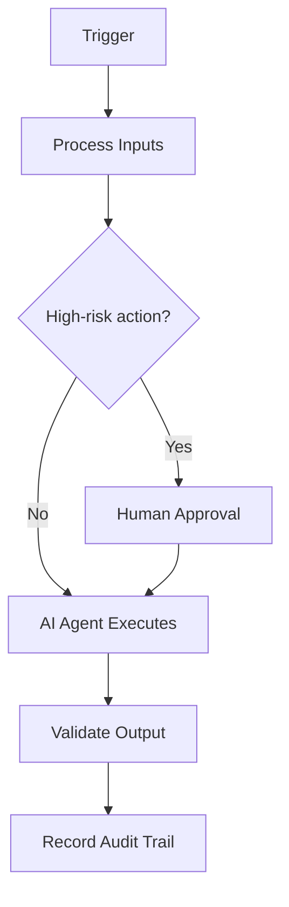

# Accessibility Monitoring

## Executive Summary

This document defines **Accessibility Monitoring** within the AIBOS Enterprise v2.0 framework (Phase 12). It inherits every root standard and is designed to be enterprise-ready, machine-readable and AI-friendly.

## Purpose

To establish the authoritative, reusable definition of Accessibility Monitoring so that human teams and AI agents operate consistently, safely and with measurable business value.

## Scope

Applies across the AIBOS enterprise and is inherited by all dependent artefacts. Concerns owned elsewhere are delegated to their owning documents to avoid duplication.

## Business Value

Reduced duplication, faster safe delivery, improved compliance posture and scalable AI augmentation.

## Trigger Events

This section (Trigger Events) for **Accessibility Monitoring** is defined in line with the AIBOS root standards and the governing Phase 12 master prompt. See `ROOT_INDEX.md` for related artefacts and `00_ROOT/` for the inherited standards.

## Inputs

This section (Inputs) for **Accessibility Monitoring** is defined in line with the AIBOS root standards and the governing Phase 12 master prompt. See `ROOT_INDEX.md` for related artefacts and `00_ROOT/` for the inherited standards.

## Outputs

This section (Outputs) for **Accessibility Monitoring** is defined in line with the AIBOS root standards and the governing Phase 12 master prompt. See `ROOT_INDEX.md` for related artefacts and `00_ROOT/` for the inherited standards.

## Workflow Description

This section (Workflow Description) for **Accessibility Monitoring** is defined in line with the AIBOS root standards and the governing Phase 12 master prompt. See `ROOT_INDEX.md` for related artefacts and `00_ROOT/` for the inherited standards.

## Mermaid Diagram

## AI Agents Involved

This section (AI Agents Involved) for **Accessibility Monitoring** is defined in line with the AIBOS root standards and the governing Phase 12 master prompt. See `ROOT_INDEX.md` for related artefacts and `00_ROOT/` for the inherited standards.

## Human Approval Points

This section (Human Approval Points) for **Accessibility Monitoring** is defined in line with the AIBOS root standards and the governing Phase 12 master prompt. See `ROOT_INDEX.md` for related artefacts and `00_ROOT/` for the inherited standards.

## Automation Opportunities

This section (Automation Opportunities) for **Accessibility Monitoring** is defined in line with the AIBOS root standards and the governing Phase 12 master prompt. See `ROOT_INDEX.md` for related artefacts and `00_ROOT/` for the inherited standards.

## Tool Integrations

This section (Tool Integrations) for **Accessibility Monitoring** is defined in line with the AIBOS root standards and the governing Phase 12 master prompt. See `ROOT_INDEX.md` for related artefacts and `00_ROOT/` for the inherited standards.

## Required Skills

- Inherits all root standards under `00_ROOT/`.
- Cross-references the relevant Phase artefacts under `02_ARTEFACTS/`.
- See `ROOT_INDEX.md` for the full catalogue.

## Governing Rules

- Inherits all root standards under `00_ROOT/`.
- Cross-references the relevant Phase artefacts under `02_ARTEFACTS/`.
- See `ROOT_INDEX.md` for the full catalogue.

## Required Checklists

- Inherits all root standards under `00_ROOT/`.
- Cross-references the relevant Phase artefacts under `02_ARTEFACTS/`.
- See `ROOT_INDEX.md` for the full catalogue.

## Supporting Playbooks

- Inherits all root standards under `00_ROOT/`.
- Cross-references the relevant Phase artefacts under `02_ARTEFACTS/`.
- See `ROOT_INDEX.md` for the full catalogue.

## Required Templates

- Inherits all root standards under `00_ROOT/`.
- Cross-references the relevant Phase artefacts under `02_ARTEFACTS/`.
- See `ROOT_INDEX.md` for the full catalogue.

## Knowledge Dependencies

- Inherits all root standards under `00_ROOT/`.
- Cross-references the relevant Phase artefacts under `02_ARTEFACTS/`.
- See `ROOT_INDEX.md` for the full catalogue.

## Monitoring Strategy

This section (Monitoring Strategy) for **Accessibility Monitoring** is defined in line with the AIBOS root standards and the governing Phase 12 master prompt. See `ROOT_INDEX.md` for related artefacts and `00_ROOT/` for the inherited standards.

## Alerting Strategy

This section (Alerting Strategy) for **Accessibility Monitoring** is defined in line with the AIBOS root standards and the governing Phase 12 master prompt. See `ROOT_INDEX.md` for related artefacts and `00_ROOT/` for the inherited standards.

## Metrics

- Coverage and completeness of the artefact.
- Validation pass rate (target 95%+).
- Cycle time from draft to approval.
- Reuse rate across the enterprise.

## KPIs

- Coverage and completeness of the artefact.
- Validation pass rate (target 95%+).
- Cycle time from draft to approval.
- Reuse rate across the enterprise.

## SLAs/SLOs

- Coverage and completeness of the artefact.
- Validation pass rate (target 95%+).
- Cycle time from draft to approval.
- Reuse rate across the enterprise.

## Error Handling

This section (Error Handling) for **Accessibility Monitoring** is defined in line with the AIBOS root standards and the governing Phase 12 master prompt. See `ROOT_INDEX.md` for related artefacts and `00_ROOT/` for the inherited standards.

## Rollback Strategy

This section (Rollback Strategy) for **Accessibility Monitoring** is defined in line with the AIBOS root standards and the governing Phase 12 master prompt. See `ROOT_INDEX.md` for related artefacts and `00_ROOT/` for the inherited standards.

## Security Controls

- Authentication and authorisation enforced.
- Encryption in transit and at rest.
- Audit logging and monitoring.

## Privacy Controls

- Data minimisation.
- Purpose limitation.
- Retention and secure deletion policies.

## Compliance Mapping

| Standard | Application |
| --- | --- |
| ISO 42001 | AI management system alignment. |
| ISO 27001 | Information security controls. |
| NIST AI RMF | AI risk management. |
| OWASP LLM Top 10 | LLM threat mitigation. |

## Cost Optimisation

This section (Cost Optimisation) for **Accessibility Monitoring** is defined in line with the AIBOS root standards and the governing Phase 12 master prompt. See `ROOT_INDEX.md` for related artefacts and `00_ROOT/` for the inherited standards.

## Continuous Improvement Loop

This section (Continuous Improvement Loop) for **Accessibility Monitoring** is defined in line with the AIBOS root standards and the governing Phase 12 master prompt. See `ROOT_INDEX.md` for related artefacts and `00_ROOT/` for the inherited standards.

## Validation Checklist

- [ ] YAML front matter is present and valid.
- [ ] All mandatory sections are complete.
- [ ] Terminology matches the AIBOS Enterprise Glossary.
- [ ] Cross-references resolve to existing documents.
- [ ] RFC 2119 keywords are used correctly.
- [ ] Security and privacy considerations are addressed.
- [ ] Version history is updated.
- [ ] No secrets or sensitive data are exposed.

## References

This section (References) for **Accessibility Monitoring** is defined in line with the AIBOS root standards and the governing Phase 12 master prompt. See `ROOT_INDEX.md` for related artefacts and `00_ROOT/` for the inherited standards.

## Version History

| Version | Date | Summary |
| --- | --- | --- |
| 2.0.0 | 2026-06-26 | Initial generated artefact. |
