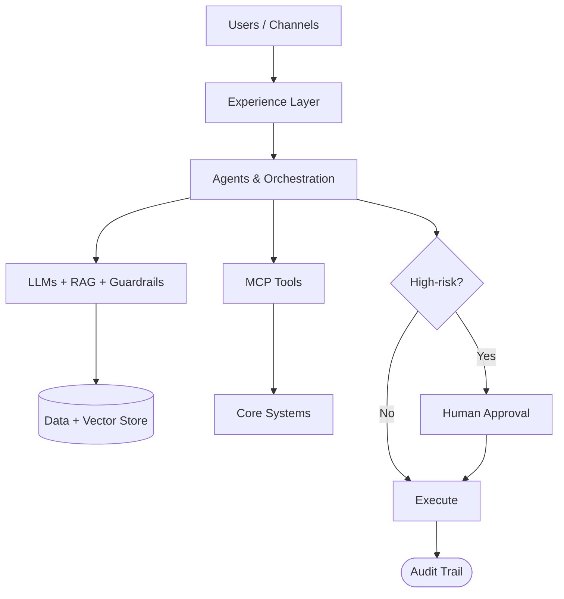

# Higher Education Reference Architecture

> **Navigate:** [Home](../../../README.md) · [Catalogue](../../../ROOT_INDEX.md) · [Higher Education Pack](./README.md) · [Phase 13 Prompt](../../../01_PHASES/PHASE_13_INDUSTRY_BLUEPRINTS_MASTER_PROMPT.md)

**Industry:** Higher Education  •  **Document:** Reference Architecture

## Executive Summary

A vendor-neutral reference architecture for AI in Higher Education, built on the AIBOS platform standards.

## Reference Architecture

- Experience layer: apps, assistants and channels.
- Agent/orchestration layer: agents, tools (MCP), workflows.
- AI layer: LLMs, RAG, evaluation and guardrails.
- Data layer: sources, pipelines, vector store, governance.
- Platform layer: cloud, security, observability.

## Technology Stack

- Cloud-native runtime and managed services.
- API-first interfaces (OpenAPI) and event-driven messaging.
- Vector database and RAG components.
- Agent framework with tracing and guardrails.
- OpenTelemetry-based observability.

## Data Sources

- SIS
- LMS
- Research repositories
- CRM

## Integration Patterns

- Event-driven integration with idempotent consumers.
- Governed APIs and MCP tools for system access.
- Retry, back-off and dead-letter handling.

## Mermaid Architecture Diagram

## Governance Model

- Risk-tiered oversight aligned to ISO 42001 / NIST AI RMF.
- Human-in-the-loop for high-impact decisions.
- Full audit trails and evaluation gates.

## Required Skills

See the [Specialist Skills](../../PHASE_05_SKILLS/README.md).

## Required Rules

See the [Enterprise Rules](../../PHASE_06_RULES/README.md).

## Required Checklists

See the [Enterprise Checklists](../../PHASE_07_CHECKLISTS/README.md).

## Required Playbooks

See the [Enterprise Playbooks](../../PHASE_08_PLAYBOOKS/README.md).

## Required Templates

See the [Enterprise Templates](../../PHASE_09_TEMPLATES/README.md).

## Knowledge Dependencies

See the [Enterprise Knowledge base](../../PHASE_10_KNOWLEDGE/README.md).

## Validation Checklist

- [ ] YAML front matter present and valid.
- [ ] Industry-specific content is accurate and actionable.
- [ ] Cross-references resolve.
- [ ] Security, privacy and compliance addressed.
- [ ] No secrets or sensitive data exposed.

## References

- [AIBOS Root Specification](../../../00_ROOT/AIBOS_ROOT_SPECIFICATION.md)
- [Repository Catalogue (ROOT_INDEX)](../../../ROOT_INDEX.md)
- [Phase 13 Master Prompt](../../../01_PHASES/PHASE_13_INDUSTRY_BLUEPRINTS_MASTER_PROMPT.md)

## Version History

| Version | Date | Summary |
| --- | --- | --- |
| 2.0.0 | 2026-06-26 | Complete, focused industry blueprint. |
