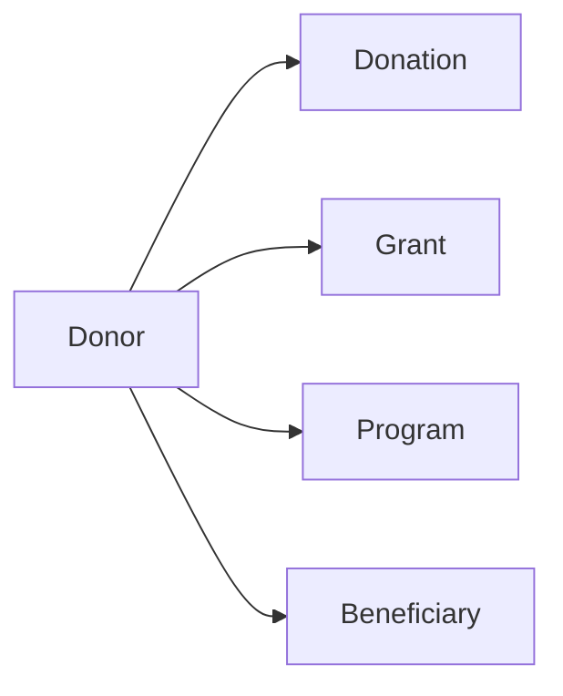

# Non-profit Organisations Data Model

> **Navigate:** [Home](../../../README.md) · [Catalogue](../../../ROOT_INDEX.md) · [Non-profit Organisations Pack](./README.md) · [Phase 13 Prompt](../../../01_PHASES/PHASE_13_INDUSTRY_BLUEPRINTS_MASTER_PROMPT.md)

**Industry:** Non-profit Organisations  •  **Document:** Data Model

## Executive Summary

The core data entities and sources that power AI in Non-profit Organisations.

## Core Entities

| Entity | Description |
| --- | --- |
| Donor | Core Non-profit Organisations entity. |
| Donation | Core Non-profit Organisations entity. |
| Grant | Core Non-profit Organisations entity. |
| Program | Core Non-profit Organisations entity. |
| Beneficiary | Core Non-profit Organisations entity. |
| Volunteer | Core Non-profit Organisations entity. |
| Campaign | Core Non-profit Organisations entity. |

## Relationships

- Entities relate through clear keys and ownership.
- Events capture state changes for analytics and agents.
- Sensitive entities carry classification and retention.

## Mermaid Entity Diagram

## Data Sources

- CRM/donor systems
- Grant systems
- Program data
- Finance

## Privacy Controls

- Data minimisation and purpose limitation.
- Encryption and masking of sensitive fields.
- Retention and secure-deletion policies.

## Required Skills

See the [Specialist Skills](../../PHASE_05_SKILLS/README.md).

## Required Rules

See the [Enterprise Rules](../../PHASE_06_RULES/README.md).

## Required Checklists

See the [Enterprise Checklists](../../PHASE_07_CHECKLISTS/README.md).

## Required Playbooks

See the [Enterprise Playbooks](../../PHASE_08_PLAYBOOKS/README.md).

## Required Templates

See the [Enterprise Templates](../../PHASE_09_TEMPLATES/README.md).

## Knowledge Dependencies

See the [Enterprise Knowledge base](../../PHASE_10_KNOWLEDGE/README.md).

## Validation Checklist

- [ ] YAML front matter present and valid.
- [ ] Industry-specific content is accurate and actionable.
- [ ] Cross-references resolve.
- [ ] Security, privacy and compliance addressed.
- [ ] No secrets or sensitive data exposed.

## References

- [AIBOS Root Specification](../../../00_ROOT/AIBOS_ROOT_SPECIFICATION.md)
- [Repository Catalogue (ROOT_INDEX)](../../../ROOT_INDEX.md)
- [Phase 13 Master Prompt](../../../01_PHASES/PHASE_13_INDUSTRY_BLUEPRINTS_MASTER_PROMPT.md)

## Version History

| Version | Date | Summary |
| --- | --- | --- |
| 2.0.0 | 2026-06-26 | Complete, focused industry blueprint. |
