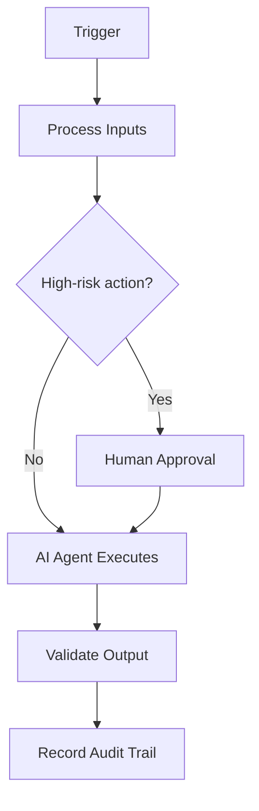

# SaaS Companies Compliance Model

## Executive Summary

This document defines **SaaS Companies Compliance Model** within the AIBOS Enterprise v2.0 framework (Phase 13). It inherits every root standard and is designed to be enterprise-ready, machine-readable and AI-friendly.

## Business Challenges

This section (Business Challenges) for **SaaS Companies Compliance Model** is defined in line with the AIBOS root standards and the governing Phase 13 master prompt. See `ROOT_INDEX.md` for related artefacts and `00_ROOT/` for the inherited standards.

## Business Goals

This section (Business Goals) for **SaaS Companies Compliance Model** is defined in line with the AIBOS root standards and the governing Phase 13 master prompt. See `ROOT_INDEX.md` for related artefacts and `00_ROOT/` for the inherited standards.

## AI Opportunities

This section (AI Opportunities) for **SaaS Companies Compliance Model** is defined in line with the AIBOS root standards and the governing Phase 13 master prompt. See `ROOT_INDEX.md` for related artefacts and `00_ROOT/` for the inherited standards.

## Recommended AI Use Cases

This section (Recommended AI Use Cases) for **SaaS Companies Compliance Model** is defined in line with the AIBOS root standards and the governing Phase 13 master prompt. See `ROOT_INDEX.md` for related artefacts and `00_ROOT/` for the inherited standards.

## AI Agent Portfolio

This section (AI Agent Portfolio) for **SaaS Companies Compliance Model** is defined in line with the AIBOS root standards and the governing Phase 13 master prompt. See `ROOT_INDEX.md` for related artefacts and `00_ROOT/` for the inherited standards.

## Business Capability Map

This section (Business Capability Map) for **SaaS Companies Compliance Model** is defined in line with the AIBOS root standards and the governing Phase 13 master prompt. See `ROOT_INDEX.md` for related artefacts and `00_ROOT/` for the inherited standards.

## Target Operating Model

This section (Target Operating Model) for **SaaS Companies Compliance Model** is defined in line with the AIBOS root standards and the governing Phase 13 master prompt. See `ROOT_INDEX.md` for related artefacts and `00_ROOT/` for the inherited standards.

## Reference Architecture

This section (Reference Architecture) for **SaaS Companies Compliance Model** is defined in line with the AIBOS root standards and the governing Phase 13 master prompt. See `ROOT_INDEX.md` for related artefacts and `00_ROOT/` for the inherited standards.

## Technology Stack

This section (Technology Stack) for **SaaS Companies Compliance Model** is defined in line with the AIBOS root standards and the governing Phase 13 master prompt. See `ROOT_INDEX.md` for related artefacts and `00_ROOT/` for the inherited standards.

## Data Sources

This section (Data Sources) for **SaaS Companies Compliance Model** is defined in line with the AIBOS root standards and the governing Phase 13 master prompt. See `ROOT_INDEX.md` for related artefacts and `00_ROOT/` for the inherited standards.

## Integration Patterns

This section (Integration Patterns) for **SaaS Companies Compliance Model** is defined in line with the AIBOS root standards and the governing Phase 13 master prompt. See `ROOT_INDEX.md` for related artefacts and `00_ROOT/` for the inherited standards.

## Security Controls

- Authentication and authorisation enforced.
- Encryption in transit and at rest.
- Audit logging and monitoring.

## Privacy Controls

- Data minimisation.
- Purpose limitation.
- Retention and secure deletion policies.

## Compliance Mapping

| Standard | Application |
| --- | --- |
| ISO 42001 | AI management system alignment. |
| ISO 27001 | Information security controls. |
| NIST AI RMF | AI risk management. |
| OWASP LLM Top 10 | LLM threat mitigation. |

## Governance Model

This section (Governance Model) for **SaaS Companies Compliance Model** is defined in line with the AIBOS root standards and the governing Phase 13 master prompt. See `ROOT_INDEX.md` for related artefacts and `00_ROOT/` for the inherited standards.

## Required Skills

- Inherits all root standards under `00_ROOT/`.
- Cross-references the relevant Phase artefacts under `02_ARTEFACTS/`.
- See `ROOT_INDEX.md` for the full catalogue.

## Required Rules

- Inherits all root standards under `00_ROOT/`.
- Cross-references the relevant Phase artefacts under `02_ARTEFACTS/`.
- See `ROOT_INDEX.md` for the full catalogue.

## Required Checklists

- Inherits all root standards under `00_ROOT/`.
- Cross-references the relevant Phase artefacts under `02_ARTEFACTS/`.
- See `ROOT_INDEX.md` for the full catalogue.

## Required Playbooks

- Inherits all root standards under `00_ROOT/`.
- Cross-references the relevant Phase artefacts under `02_ARTEFACTS/`.
- See `ROOT_INDEX.md` for the full catalogue.

## Required Templates

- Inherits all root standards under `00_ROOT/`.
- Cross-references the relevant Phase artefacts under `02_ARTEFACTS/`.
- See `ROOT_INDEX.md` for the full catalogue.

## Knowledge Dependencies

- Inherits all root standards under `00_ROOT/`.
- Cross-references the relevant Phase artefacts under `02_ARTEFACTS/`.
- See `ROOT_INDEX.md` for the full catalogue.

## KPIs

- Coverage and completeness of the artefact.
- Validation pass rate (target 95%+).
- Cycle time from draft to approval.
- Reuse rate across the enterprise.

## ROI Metrics

- Coverage and completeness of the artefact.
- Validation pass rate (target 95%+).
- Cycle time from draft to approval.
- Reuse rate across the enterprise.

## Cost Considerations

This section (Cost Considerations) for **SaaS Companies Compliance Model** is defined in line with the AIBOS root standards and the governing Phase 13 master prompt. See `ROOT_INDEX.md` for related artefacts and `00_ROOT/` for the inherited standards.

## Risks

- Scope drift over time.
- Inconsistent adoption across teams.
- Over-automation without adequate oversight.

## Adoption Roadmap

| Horizon | Focus | Outcome |
| --- | --- | --- |
| 0-30 days | Discover and assess | Baseline established |
| 31-60 days | Design and build | Pilot delivered |
| 61-90 days | Validate and scale | Production rollout |

## Change Management

This section (Change Management) for **SaaS Companies Compliance Model** is defined in line with the AIBOS root standards and the governing Phase 13 master prompt. See `ROOT_INDEX.md` for related artefacts and `00_ROOT/` for the inherited standards.

## Mermaid Architecture Diagrams

## Validation Checklist

- [ ] YAML front matter is present and valid.
- [ ] All mandatory sections are complete.
- [ ] Terminology matches the AIBOS Enterprise Glossary.
- [ ] Cross-references resolve to existing documents.
- [ ] RFC 2119 keywords are used correctly.
- [ ] Security and privacy considerations are addressed.
- [ ] Version history is updated.
- [ ] No secrets or sensitive data are exposed.

## References

This section (References) for **SaaS Companies Compliance Model** is defined in line with the AIBOS root standards and the governing Phase 13 master prompt. See `ROOT_INDEX.md` for related artefacts and `00_ROOT/` for the inherited standards.

## Version History

| Version | Date | Summary |
| --- | --- | --- |
| 2.0.0 | 2026-06-26 | Initial generated artefact. |
