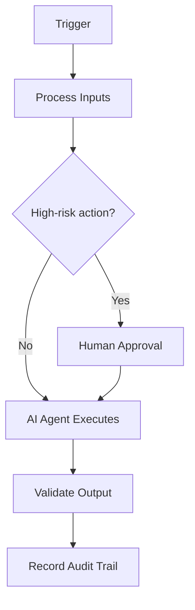

# Logging

> **Navigate:** [Home](../../../README.md) · [Catalogue](../../../ROOT_INDEX.md) · [Generated Index](../../README.md) · [Phase 15 Prompt](../../../01_PHASES/PHASE_15_ENTERPRISE_REFERENCE_IMPLEMENTATIONS_MASTER_PROMPT.md)

## Purpose

To establish the authoritative, reusable definition of Logging so that human teams and AI agents operate consistently, safely and with measurable business value.

## Scope

Applies across the AIBOS enterprise and is inherited by all dependent artefacts. Concerns owned elsewhere are delegated to their owning documents to avoid duplication.

## Business Scenario

This section (Business Scenario) for **Logging** is defined in line with the AIBOS root standards and the governing Phase 15 master prompt. See the [repository catalogue](../../../ROOT_INDEX.md) and the [root standards](../../../00_ROOT) for related material.

## Functional Requirements

This section (Functional Requirements) for **Logging** is defined in line with the AIBOS root standards and the governing Phase 15 master prompt. See the [repository catalogue](../../../ROOT_INDEX.md) and the [root standards](../../../00_ROOT) for related material.

## Non-functional Requirements

This section (Non-functional Requirements) for **Logging** is defined in line with the AIBOS root standards and the governing Phase 15 master prompt. See the [repository catalogue](../../../ROOT_INDEX.md) and the [root standards](../../../00_ROOT) for related material.

## Architecture Overview

This section (Architecture Overview) for **Logging** is defined in line with the AIBOS root standards and the governing Phase 15 master prompt. See the [repository catalogue](../../../ROOT_INDEX.md) and the [root standards](../../../00_ROOT) for related material.

## Mermaid Architecture Diagrams

## Repository Structure

This section (Repository Structure) for **Logging** is defined in line with the AIBOS root standards and the governing Phase 15 master prompt. See the [repository catalogue](../../../ROOT_INDEX.md) and the [root standards](../../../00_ROOT) for related material.

## Folder Layout

This section (Folder Layout) for **Logging** is defined in line with the AIBOS root standards and the governing Phase 15 master prompt. See the [repository catalogue](../../../ROOT_INDEX.md) and the [root standards](../../../00_ROOT) for related material.

## Technology Stack

- Cloud-native runtime and managed services.
- API-first interfaces (OpenAPI) and event-driven messaging.
- Vector database and RAG components where applicable.
- OpenTelemetry-based observability.

## Deployment Model

This section (Deployment Model) for **Logging** is defined in line with the AIBOS root standards and the governing Phase 15 master prompt. See the [repository catalogue](../../../ROOT_INDEX.md) and the [root standards](../../../00_ROOT) for related material.

## Infrastructure Components

This section (Infrastructure Components) for **Logging** is defined in line with the AIBOS root standards and the governing Phase 15 master prompt. See the [repository catalogue](../../../ROOT_INDEX.md) and the [root standards](../../../00_ROOT) for related material.

## Security Controls

- Authentication and authorisation enforced.
- Encryption in transit and at rest.
- Audit logging and continuous monitoring.

## AI Components

This section (AI Components) for **Logging** is defined in line with the AIBOS root standards and the governing Phase 15 master prompt. See the [repository catalogue](../../../ROOT_INDEX.md) and the [root standards](../../../00_ROOT) for related material.

## Data Flow

This section (Data Flow) for **Logging** is defined in line with the AIBOS root standards and the governing Phase 15 master prompt. See the [repository catalogue](../../../ROOT_INDEX.md) and the [root standards](../../../00_ROOT) for related material.

## Integration Flow

This section (Integration Flow) for **Logging** is defined in line with the AIBOS root standards and the governing Phase 15 master prompt. See the [repository catalogue](../../../ROOT_INDEX.md) and the [root standards](../../../00_ROOT) for related material.

## API Contracts

This section (API Contracts) for **Logging** is defined in line with the AIBOS root standards and the governing Phase 15 master prompt. See the [repository catalogue](../../../ROOT_INDEX.md) and the [root standards](../../../00_ROOT) for related material.

## Configuration Strategy

This section (Configuration Strategy) for **Logging** is defined in line with the AIBOS root standards and the governing Phase 15 master prompt. See the [repository catalogue](../../../ROOT_INDEX.md) and the [root standards](../../../00_ROOT) for related material.

## Secrets Strategy

This section (Secrets Strategy) for **Logging** is defined in line with the AIBOS root standards and the governing Phase 15 master prompt. See the [repository catalogue](../../../ROOT_INDEX.md) and the [root standards](../../../00_ROOT) for related material.

## Monitoring Strategy

This section (Monitoring Strategy) for **Logging** is defined in line with the AIBOS root standards and the governing Phase 15 master prompt. See the [repository catalogue](../../../ROOT_INDEX.md) and the [root standards](../../../00_ROOT) for related material.

## Logging Strategy

This section (Logging Strategy) for **Logging** is defined in line with the AIBOS root standards and the governing Phase 15 master prompt. See the [repository catalogue](../../../ROOT_INDEX.md) and the [root standards](../../../00_ROOT) for related material.

## Testing Strategy

This section (Testing Strategy) for **Logging** is defined in line with the AIBOS root standards and the governing Phase 15 master prompt. See the [repository catalogue](../../../ROOT_INDEX.md) and the [root standards](../../../00_ROOT) for related material.

## Scalability Strategy

This section (Scalability Strategy) for **Logging** is defined in line with the AIBOS root standards and the governing Phase 15 master prompt. See the [repository catalogue](../../../ROOT_INDEX.md) and the [root standards](../../../00_ROOT) for related material.

## Disaster Recovery

This section (Disaster Recovery) for **Logging** is defined in line with the AIBOS root standards and the governing Phase 15 master prompt. See the [repository catalogue](../../../ROOT_INDEX.md) and the [root standards](../../../00_ROOT) for related material.

## Cost Optimisation

This section (Cost Optimisation) for **Logging** is defined in line with the AIBOS root standards and the governing Phase 15 master prompt. See the [repository catalogue](../../../ROOT_INDEX.md) and the [root standards](../../../00_ROOT) for related material.

## Required Skills

- See **[Specialist Skills (Phase 05)](../../PHASE_05_SKILLS/README.md)** for the relevant artefacts.
- Inherited standards: [AIBOS Root Specification](../../../00_ROOT/AIBOS_ROOT_SPECIFICATION.md).
- Full catalogue: [ROOT_INDEX](../../../ROOT_INDEX.md).

## Required Rules

- See **[Enterprise Rules (Phase 06)](../../PHASE_06_RULES/README.md)** for the relevant artefacts.
- Inherited standards: [AIBOS Root Specification](../../../00_ROOT/AIBOS_ROOT_SPECIFICATION.md).
- Full catalogue: [ROOT_INDEX](../../../ROOT_INDEX.md).

## Required Checklists

- See **[Enterprise Checklists (Phase 07)](../../PHASE_07_CHECKLISTS/README.md)** for the relevant artefacts.
- Inherited standards: [AIBOS Root Specification](../../../00_ROOT/AIBOS_ROOT_SPECIFICATION.md).
- Full catalogue: [ROOT_INDEX](../../../ROOT_INDEX.md).

## Required Playbooks

- See **[Enterprise Playbooks (Phase 08)](../../PHASE_08_PLAYBOOKS/README.md)** for the relevant artefacts.
- Inherited standards: [AIBOS Root Specification](../../../00_ROOT/AIBOS_ROOT_SPECIFICATION.md).
- Full catalogue: [ROOT_INDEX](../../../ROOT_INDEX.md).

## Required Templates

- See **[Enterprise Templates (Phase 09)](../../PHASE_09_TEMPLATES/README.md)** for the relevant artefacts.
- Inherited standards: [AIBOS Root Specification](../../../00_ROOT/AIBOS_ROOT_SPECIFICATION.md).
- Full catalogue: [ROOT_INDEX](../../../ROOT_INDEX.md).

## Required Knowledge

- See **[Enterprise Knowledge (Phase 10)](../../PHASE_10_KNOWLEDGE/README.md)** for the relevant artefacts.
- Inherited standards: [AIBOS Root Specification](../../../00_ROOT/AIBOS_ROOT_SPECIFICATION.md).
- Full catalogue: [ROOT_INDEX](../../../ROOT_INDEX.md).

## Related Industry Blueprints

- See **[Industry Blueprints (Phase 13)](../../PHASE_13_INDUSTRY_BLUEPRINTS/README.md)** for the relevant artefacts.
- Inherited standards: [AIBOS Root Specification](../../../00_ROOT/AIBOS_ROOT_SPECIFICATION.md).
- Full catalogue: [ROOT_INDEX](../../../ROOT_INDEX.md).

## Validation Checklist

- [ ] YAML front matter is present and valid.
- [ ] All mandatory sections are complete.
- [ ] Terminology matches the AIBOS Enterprise Glossary.
- [ ] Cross-references resolve to existing documents.
- [ ] RFC 2119 keywords are used correctly.
- [ ] Security and privacy considerations are addressed.
- [ ] Version history is updated.
- [ ] No secrets or sensitive data are exposed.

## References

- [AIBOS Root Specification](../../../00_ROOT/AIBOS_ROOT_SPECIFICATION.md)
- [Enterprise Glossary](../../../00_ROOT/AIBOS_ENTERPRISE_GLOSSARY.md)
- [Document Schema](../../../00_ROOT/AIBOS_DOCUMENT_SCHEMA.md)
- [Repository Catalogue (ROOT_INDEX)](../../../ROOT_INDEX.md)
- [Phase 15 Master Prompt](../../../01_PHASES/PHASE_15_ENTERPRISE_REFERENCE_IMPLEMENTATIONS_MASTER_PROMPT.md)

## Version History

| Version | Date | Summary |
| --- | --- | --- |
| 2.0.0 | 2026-06-26 | Initial generated artefact. |
