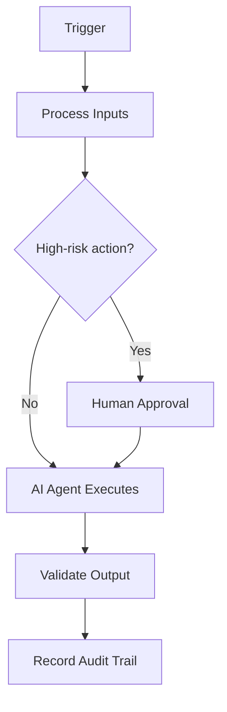

# Dashboards

## Purpose

To establish the authoritative, reusable definition of Dashboards so that human teams and AI agents operate consistently, safely and with measurable business value.

## Scope

Applies across the AIBOS enterprise and is inherited by all dependent artefacts. Concerns owned elsewhere are delegated to their owning documents to avoid duplication.

## Business Scenario

This section (Business Scenario) for **Dashboards** is defined in line with the AIBOS root standards and the governing Phase 15 master prompt. See `ROOT_INDEX.md` for related artefacts and `00_ROOT/` for the inherited standards.

## Functional Requirements

This section (Functional Requirements) for **Dashboards** is defined in line with the AIBOS root standards and the governing Phase 15 master prompt. See `ROOT_INDEX.md` for related artefacts and `00_ROOT/` for the inherited standards.

## Non-functional Requirements

This section (Non-functional Requirements) for **Dashboards** is defined in line with the AIBOS root standards and the governing Phase 15 master prompt. See `ROOT_INDEX.md` for related artefacts and `00_ROOT/` for the inherited standards.

## Architecture Overview

This section (Architecture Overview) for **Dashboards** is defined in line with the AIBOS root standards and the governing Phase 15 master prompt. See `ROOT_INDEX.md` for related artefacts and `00_ROOT/` for the inherited standards.

## Mermaid Architecture Diagrams

## Repository Structure

This section (Repository Structure) for **Dashboards** is defined in line with the AIBOS root standards and the governing Phase 15 master prompt. See `ROOT_INDEX.md` for related artefacts and `00_ROOT/` for the inherited standards.

## Folder Layout

This section (Folder Layout) for **Dashboards** is defined in line with the AIBOS root standards and the governing Phase 15 master prompt. See `ROOT_INDEX.md` for related artefacts and `00_ROOT/` for the inherited standards.

## Technology Stack

This section (Technology Stack) for **Dashboards** is defined in line with the AIBOS root standards and the governing Phase 15 master prompt. See `ROOT_INDEX.md` for related artefacts and `00_ROOT/` for the inherited standards.

## Deployment Model

This section (Deployment Model) for **Dashboards** is defined in line with the AIBOS root standards and the governing Phase 15 master prompt. See `ROOT_INDEX.md` for related artefacts and `00_ROOT/` for the inherited standards.

## Infrastructure Components

This section (Infrastructure Components) for **Dashboards** is defined in line with the AIBOS root standards and the governing Phase 15 master prompt. See `ROOT_INDEX.md` for related artefacts and `00_ROOT/` for the inherited standards.

## Security Controls

- Authentication and authorisation enforced.
- Encryption in transit and at rest.
- Audit logging and monitoring.

## AI Components

This section (AI Components) for **Dashboards** is defined in line with the AIBOS root standards and the governing Phase 15 master prompt. See `ROOT_INDEX.md` for related artefacts and `00_ROOT/` for the inherited standards.

## Data Flow

This section (Data Flow) for **Dashboards** is defined in line with the AIBOS root standards and the governing Phase 15 master prompt. See `ROOT_INDEX.md` for related artefacts and `00_ROOT/` for the inherited standards.

## Integration Flow

This section (Integration Flow) for **Dashboards** is defined in line with the AIBOS root standards and the governing Phase 15 master prompt. See `ROOT_INDEX.md` for related artefacts and `00_ROOT/` for the inherited standards.

## API Contracts

This section (API Contracts) for **Dashboards** is defined in line with the AIBOS root standards and the governing Phase 15 master prompt. See `ROOT_INDEX.md` for related artefacts and `00_ROOT/` for the inherited standards.

## Configuration Strategy

This section (Configuration Strategy) for **Dashboards** is defined in line with the AIBOS root standards and the governing Phase 15 master prompt. See `ROOT_INDEX.md` for related artefacts and `00_ROOT/` for the inherited standards.

## Secrets Strategy

This section (Secrets Strategy) for **Dashboards** is defined in line with the AIBOS root standards and the governing Phase 15 master prompt. See `ROOT_INDEX.md` for related artefacts and `00_ROOT/` for the inherited standards.

## Monitoring Strategy

This section (Monitoring Strategy) for **Dashboards** is defined in line with the AIBOS root standards and the governing Phase 15 master prompt. See `ROOT_INDEX.md` for related artefacts and `00_ROOT/` for the inherited standards.

## Logging Strategy

This section (Logging Strategy) for **Dashboards** is defined in line with the AIBOS root standards and the governing Phase 15 master prompt. See `ROOT_INDEX.md` for related artefacts and `00_ROOT/` for the inherited standards.

## Testing Strategy

This section (Testing Strategy) for **Dashboards** is defined in line with the AIBOS root standards and the governing Phase 15 master prompt. See `ROOT_INDEX.md` for related artefacts and `00_ROOT/` for the inherited standards.

## Scalability Strategy

This section (Scalability Strategy) for **Dashboards** is defined in line with the AIBOS root standards and the governing Phase 15 master prompt. See `ROOT_INDEX.md` for related artefacts and `00_ROOT/` for the inherited standards.

## Disaster Recovery

This section (Disaster Recovery) for **Dashboards** is defined in line with the AIBOS root standards and the governing Phase 15 master prompt. See `ROOT_INDEX.md` for related artefacts and `00_ROOT/` for the inherited standards.

## Cost Optimisation

This section (Cost Optimisation) for **Dashboards** is defined in line with the AIBOS root standards and the governing Phase 15 master prompt. See `ROOT_INDEX.md` for related artefacts and `00_ROOT/` for the inherited standards.

## Required Skills

- Inherits all root standards under `00_ROOT/`.
- Cross-references the relevant Phase artefacts under `02_ARTEFACTS/`.
- See `ROOT_INDEX.md` for the full catalogue.

## Required Rules

- Inherits all root standards under `00_ROOT/`.
- Cross-references the relevant Phase artefacts under `02_ARTEFACTS/`.
- See `ROOT_INDEX.md` for the full catalogue.

## Required Checklists

- Inherits all root standards under `00_ROOT/`.
- Cross-references the relevant Phase artefacts under `02_ARTEFACTS/`.
- See `ROOT_INDEX.md` for the full catalogue.

## Required Playbooks

- Inherits all root standards under `00_ROOT/`.
- Cross-references the relevant Phase artefacts under `02_ARTEFACTS/`.
- See `ROOT_INDEX.md` for the full catalogue.

## Required Templates

- Inherits all root standards under `00_ROOT/`.
- Cross-references the relevant Phase artefacts under `02_ARTEFACTS/`.
- See `ROOT_INDEX.md` for the full catalogue.

## Required Knowledge

- Inherits all root standards under `00_ROOT/`.
- Cross-references the relevant Phase artefacts under `02_ARTEFACTS/`.
- See `ROOT_INDEX.md` for the full catalogue.

## Related Industry Blueprints

- Inherits all root standards under `00_ROOT/`.
- Cross-references the relevant Phase artefacts under `02_ARTEFACTS/`.
- See `ROOT_INDEX.md` for the full catalogue.

## Validation Checklist

- [ ] YAML front matter is present and valid.
- [ ] All mandatory sections are complete.
- [ ] Terminology matches the AIBOS Enterprise Glossary.
- [ ] Cross-references resolve to existing documents.
- [ ] RFC 2119 keywords are used correctly.
- [ ] Security and privacy considerations are addressed.
- [ ] Version history is updated.
- [ ] No secrets or sensitive data are exposed.

## References

This section (References) for **Dashboards** is defined in line with the AIBOS root standards and the governing Phase 15 master prompt. See `ROOT_INDEX.md` for related artefacts and `00_ROOT/` for the inherited standards.

## Version History

| Version | Date | Summary |
| --- | --- | --- |
| 2.0.0 | 2026-06-26 | Initial generated artefact. |
