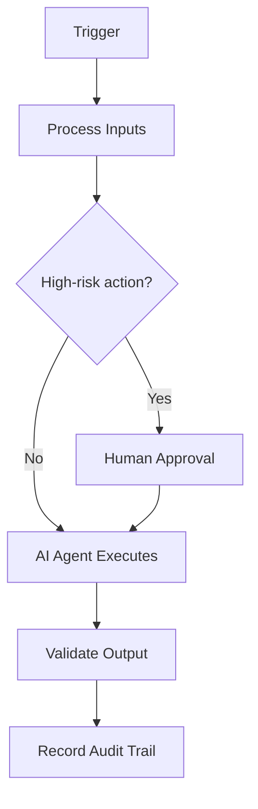

# Secure Supply Chain

> **Navigate:** [Home](../../../README.md) · [Catalogue](../../../ROOT_INDEX.md) · [Generated Index](../../README.md) · [Phase 15 Prompt](../../../01_PHASES/PHASE_15_ENTERPRISE_REFERENCE_IMPLEMENTATIONS_MASTER_PROMPT.md)

## Purpose

To establish the authoritative, reusable definition of Secure Supply Chain so that human teams and AI agents operate consistently, safely and with measurable business value.

## Scope

Applies across the AIBOS enterprise and is inherited by all dependent artefacts. Concerns owned elsewhere are delegated to their owning documents to avoid duplication.

## Business Scenario

- A representative secure supply chain situation and its goals.
- The actors, triggers and expected outcome.
- How AIBOS standards and agents apply, with human oversight.

## Functional Requirements

- The capability MUST deliver its defined user/business outcomes.
- Inputs are validated; outputs are correct and consistent.
- Errors and edge cases are handled gracefully.
- Behaviour is covered by tests.

## Non-functional Requirements

- Performance: defined latency/throughput targets (p95/p99).
- Reliability: availability SLOs and error budgets.
- Security and privacy by design.
- Scalability, maintainability and accessibility (WCAG 2.2 AA).

## Architecture Overview

- Experience layer: apps, assistants and channels.
- Orchestration layer: agents, tools (MCP) and workflows.
- AI layer: LLMs, RAG, evaluation and guardrails.
- Data layer: sources, pipelines, vector store and governance.
- Platform layer: cloud, security and observability.

## Mermaid Architecture Diagrams



## Repository Structure

```text
project/
  src/        # application code
  infra/      # infrastructure as code
  docs/       # documentation
  tests/      # automated tests
  .github/    # CI/CD workflows
```

## Folder Layout

```text
project/
  src/        # application code
  infra/      # infrastructure as code
  docs/       # documentation
  tests/      # automated tests
  .github/    # CI/CD workflows
```

## Technology Stack

- Cloud-native runtime and managed services.
- API-first interfaces (OpenAPI) and event-driven messaging.
- Vector database and RAG components where applicable.
- OpenTelemetry-based observability.

## Deployment Model

- Automated, versioned, traceable deployments via CI/CD.
- Progressive delivery (canary/blue-green) for risky changes.
- Post-deploy health checks with automatic rollback.

## Infrastructure Components

- Cloud-native, defined as code (Terraform/Pulumi).
- Containerised workloads with orchestration.
- Managed data, networking and security services.
- Observability and cost controls built in.

## Security Controls

- Authentication and authorisation enforced.
- Encryption in transit and at rest.
- Audit logging and continuous monitoring.

## AI Components

- LLM/model providers via a gateway.
- RAG pipeline: ingestion, retrieval and grounding.
- Evaluation and guardrails.
- Agent framework with tracing and tool (MCP) access.

## Data Flow

- Sources -> ingestion/validation -> storage.
- Retrieval/embedding for AI grounding.
- Processing and serving to apps and agents.
- Telemetry and audit captured throughout.

## Integration Flow

- Event-driven integration with idempotent consumers.
- Governed APIs (OpenAPI) and MCP tools for system access.
- Retry, back-off and dead-letter handling for resilience.
- Monitoring and alerting on every integration.

## API Contracts

- Contracts described by OpenAPI (or typed CLI help).
- Versioned with a clear deprecation policy.
- AuthN/AuthZ, validation and consistent errors.
- Documented with examples for humans and agents.

## Configuration Strategy

- Configuration via environment, separate from code (Twelve-Factor).
- Validated at startup; safe, documented defaults.
- No secrets in config — use a secrets manager.

## Secrets Strategy

- Stored in a managed secrets manager, never in code/config.
- Injected at runtime; rotated on schedule and on compromise.
- Least-privilege access, audited; CI secret-scanning enabled.

## Monitoring Strategy

- Emit metrics, logs and traces (OpenTelemetry).
- Alert on SLOs and symptoms, not noise.
- Dashboards for key services, with runbooks linked.

## Logging Strategy

- Structured, centralised logs with correlation IDs.
- No secrets or unmasked PII in logs.
- Retention aligned to policy; security events captured.

## Testing Strategy

- Automated tests proportional to risk, gating merges.
- Evaluation of AI quality and safety before release.
- Continuous measurement and regression detection.

## Scalability Strategy

- Stateless, horizontally scalable services.
- Caching, queues and autoscaling for load.
- Performance budgets and load testing.

## Disaster Recovery

- Detect, capture and classify the error with context.
- Apply a safe fallback or stop safely.
- Retry idempotently where safe; otherwise escalate.
- Open an incident if customer impact is possible.

## Cost Optimisation

- Model/compute (token) costs — align to actual usage.
- Platform, data and integration costs.
- Run and oversight costs (human-in-the-loop, monitoring).
- Track against budget and optimise continuously (FinOps).

## Required Skills

- See **[Specialist Skills (Phase 05)](../../PHASE_05_SKILLS/README.md)** for the relevant artefacts.
- Inherited standards: [AIBOS Root Specification](../../../00_ROOT/AIBOS_ROOT_SPECIFICATION.md).
- Full catalogue: [ROOT_INDEX](../../../ROOT_INDEX.md).

## Required Rules

- See **[Enterprise Rules (Phase 06)](../../PHASE_06_RULES/README.md)** for the relevant artefacts.
- Inherited standards: [AIBOS Root Specification](../../../00_ROOT/AIBOS_ROOT_SPECIFICATION.md).
- Full catalogue: [ROOT_INDEX](../../../ROOT_INDEX.md).

## Required Checklists

- See **[Enterprise Checklists (Phase 07)](../../PHASE_07_CHECKLISTS/README.md)** for the relevant artefacts.
- Inherited standards: [AIBOS Root Specification](../../../00_ROOT/AIBOS_ROOT_SPECIFICATION.md).
- Full catalogue: [ROOT_INDEX](../../../ROOT_INDEX.md).

## Required Playbooks

- See **[Enterprise Playbooks (Phase 08)](../../PHASE_08_PLAYBOOKS/README.md)** for the relevant artefacts.
- Inherited standards: [AIBOS Root Specification](../../../00_ROOT/AIBOS_ROOT_SPECIFICATION.md).
- Full catalogue: [ROOT_INDEX](../../../ROOT_INDEX.md).

## Required Templates

- See **[Enterprise Templates (Phase 09)](../../PHASE_09_TEMPLATES/README.md)** for the relevant artefacts.
- Inherited standards: [AIBOS Root Specification](../../../00_ROOT/AIBOS_ROOT_SPECIFICATION.md).
- Full catalogue: [ROOT_INDEX](../../../ROOT_INDEX.md).

## Required Knowledge

- See **[Enterprise Knowledge (Phase 10)](../../PHASE_10_KNOWLEDGE/README.md)** for the relevant artefacts.
- Inherited standards: [AIBOS Root Specification](../../../00_ROOT/AIBOS_ROOT_SPECIFICATION.md).
- Full catalogue: [ROOT_INDEX](../../../ROOT_INDEX.md).

## Related Industry Blueprints

- See **[Industry Blueprints (Phase 13)](../../PHASE_13_INDUSTRY_BLUEPRINTS/README.md)** for the relevant artefacts.
- Inherited standards: [AIBOS Root Specification](../../../00_ROOT/AIBOS_ROOT_SPECIFICATION.md).
- Full catalogue: [ROOT_INDEX](../../../ROOT_INDEX.md).

## Validation Checklist

- [ ] YAML front matter is present and valid.
- [ ] All mandatory sections are complete.
- [ ] Terminology matches the AIBOS Enterprise Glossary.
- [ ] Cross-references resolve to existing documents.
- [ ] RFC 2119 keywords are used correctly.
- [ ] Security and privacy considerations are addressed.
- [ ] Version history is updated.
- [ ] No secrets or sensitive data are exposed.

## References

- [AIBOS Root Specification](../../../00_ROOT/AIBOS_ROOT_SPECIFICATION.md)
- [Enterprise Glossary](../../../00_ROOT/AIBOS_ENTERPRISE_GLOSSARY.md)
- [Document Schema](../../../00_ROOT/AIBOS_DOCUMENT_SCHEMA.md)
- [Repository Catalogue (ROOT_INDEX)](../../../ROOT_INDEX.md)
- [Phase 15 Master Prompt](../../../01_PHASES/PHASE_15_ENTERPRISE_REFERENCE_IMPLEMENTATIONS_MASTER_PROMPT.md)

## Version History

| Version | Date | Summary |
| --- | --- | --- |
| 2.0.0 | 2026-06-26 | Initial generated artefact. |
