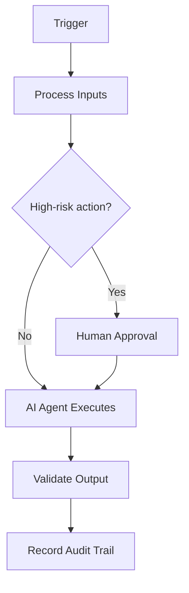

# MCP Interface

> **Navigate:** [Home](../../../README.md) · [Catalogue](../../../ROOT_INDEX.md) · [Generated Index](../../README.md) · [Phase 16 Prompt](../../../01_PHASES/PHASE_16_AIBOS_SDK_CLI_MASTER_PROMPT.md)

## Executive Summary

This document defines **MCP Interface** within the AIBOS Enterprise v2.0 framework (Phase 16). It inherits every root standard and is designed to be enterprise-ready, machine-readable and AI-friendly.

## Purpose

To establish the authoritative, reusable definition of MCP Interface so that human teams and AI agents operate consistently, safely and with measurable business value.

## Scope

Applies across the AIBOS enterprise and is inherited by all dependent artefacts. Concerns owned elsewhere are delegated to their owning documents to avoid duplication.

## Business Value

Reduced duplication, faster safe delivery, improved compliance posture and scalable AI augmentation.

## Developer Value

- Faster delivery through reuse and automation.
- Higher quality and consistency by default.
- Lower risk via built-in security and governance.

## Functional Requirements

- The capability MUST deliver its defined user/business outcomes.
- Inputs are validated; outputs are correct and consistent.
- Errors and edge cases are handled gracefully.
- Behaviour is covered by tests.

## Non-functional Requirements

- Performance: defined latency/throughput targets (p95/p99).
- Reliability: availability SLOs and error budgets.
- Security and privacy by design.
- Scalability, maintainability and accessibility (WCAG 2.2 AA).

## Public Interfaces

- Event-driven integration with idempotent consumers.
- Governed APIs (OpenAPI) and MCP tools for system access.
- Retry, back-off and dead-letter handling for resilience.
- Monitoring and alerting on every integration.

## Commands/APIs

- Contracts described by OpenAPI (or typed CLI help).
- Versioned with a clear deprecation policy.
- AuthN/AuthZ, validation and consistent errors.
- Documented with examples for humans and agents.

## Configuration Model

- Configuration via environment, separate from code (Twelve-Factor).
- Validated at startup; safe, documented defaults.
- No secrets in config — use a secrets manager.

## Authentication

- Standard protocols (OIDC/OAuth 2.1).
- MFA for privileged access; strong password hashing.
- Short-lived, scoped tokens; session revocation.

## Authorisation

- Least privilege, deny by default, server-side checks.
- RBAC/ABAC modelled explicitly.
- Privileged actions audited; periodic access reviews.

## Extension Points

- Well-defined extension points and stable interfaces.
- Versioned contracts and backward compatibility.
- Sandboxing and least privilege for extensions.

## Plugin Architecture

- Experience layer: apps, assistants and channels.
- Orchestration layer: agents, tools (MCP) and workflows.
- AI layer: LLMs, RAG, evaluation and guardrails.
- Data layer: sources, pipelines, vector store and governance.
- Platform layer: cloud, security and observability.

## Versioning Strategy

- Semantic Versioning (MAJOR.MINOR.PATCH).
- Backward compatibility within a major version.
- Documented deprecation policy and changelog.

## Backward Compatibility

- Backward compatibility within a major version.
- Deprecations announced with a migration path.
- Contract tests guard against breakage.

## Error Handling

- Detect, capture and classify the error with context.
- Apply a safe fallback or stop safely.
- Retry idempotently where safe; otherwise escalate.
- Open an incident if customer impact is possible.

## Observability

- Emit metrics, logs and traces (OpenTelemetry).
- Alert on SLOs and symptoms, not noise.
- Dashboards for key services, with runbooks linked.

## Security Controls

- Authentication and authorisation enforced.
- Encryption in transit and at rest.
- Audit logging and continuous monitoring.

## Privacy Controls

- Data minimisation.
- Purpose limitation.
- Retention and secure-deletion policies.

## Performance Targets

- Defined performance budgets/SLAs (p95/p99).
- Load and stress testing before major releases.
- Profiling and caching to remove bottlenecks.

## Testing Strategy

- Automated tests proportional to risk, gating merges.
- Evaluation of AI quality and safety before release.
- Continuous measurement and regression detection.

## CI/CD Integration

- Event-driven integration with idempotent consumers.
- Governed APIs (OpenAPI) and MCP tools for system access.
- Retry, back-off and dead-letter handling for resilience.
- Monitoring and alerting on every integration.

## Required Skills

- See **[Specialist Skills (Phase 05)](../../PHASE_05_SKILLS/README.md)** for the relevant artefacts.
- Inherited standards: [AIBOS Root Specification](../../../00_ROOT/AIBOS_ROOT_SPECIFICATION.md).
- Full catalogue: [ROOT_INDEX](../../../ROOT_INDEX.md).

## Required Rules

- See **[Enterprise Rules (Phase 06)](../../PHASE_06_RULES/README.md)** for the relevant artefacts.
- Inherited standards: [AIBOS Root Specification](../../../00_ROOT/AIBOS_ROOT_SPECIFICATION.md).
- Full catalogue: [ROOT_INDEX](../../../ROOT_INDEX.md).

## Required Checklists

- See **[Enterprise Checklists (Phase 07)](../../PHASE_07_CHECKLISTS/README.md)** for the relevant artefacts.
- Inherited standards: [AIBOS Root Specification](../../../00_ROOT/AIBOS_ROOT_SPECIFICATION.md).
- Full catalogue: [ROOT_INDEX](../../../ROOT_INDEX.md).

## Required Playbooks

- See **[Enterprise Playbooks (Phase 08)](../../PHASE_08_PLAYBOOKS/README.md)** for the relevant artefacts.
- Inherited standards: [AIBOS Root Specification](../../../00_ROOT/AIBOS_ROOT_SPECIFICATION.md).
- Full catalogue: [ROOT_INDEX](../../../ROOT_INDEX.md).

## Required Templates

- See **[Enterprise Templates (Phase 09)](../../PHASE_09_TEMPLATES/README.md)** for the relevant artefacts.
- Inherited standards: [AIBOS Root Specification](../../../00_ROOT/AIBOS_ROOT_SPECIFICATION.md).
- Full catalogue: [ROOT_INDEX](../../../ROOT_INDEX.md).

## Required Knowledge

- See **[Enterprise Knowledge (Phase 10)](../../PHASE_10_KNOWLEDGE/README.md)** for the relevant artefacts.
- Inherited standards: [AIBOS Root Specification](../../../00_ROOT/AIBOS_ROOT_SPECIFICATION.md).
- Full catalogue: [ROOT_INDEX](../../../ROOT_INDEX.md).

## Sample Usage

```yaml
# Example for: MCP Interface
name: example
version: 2.0.0
status: draft
```

## Mermaid Diagrams



## Validation Checklist

- [ ] YAML front matter is present and valid.
- [ ] All mandatory sections are complete.
- [ ] Terminology matches the AIBOS Enterprise Glossary.
- [ ] Cross-references resolve to existing documents.
- [ ] RFC 2119 keywords are used correctly.
- [ ] Security and privacy considerations are addressed.
- [ ] Version history is updated.
- [ ] No secrets or sensitive data are exposed.

## References

- [AIBOS Root Specification](../../../00_ROOT/AIBOS_ROOT_SPECIFICATION.md)
- [Enterprise Glossary](../../../00_ROOT/AIBOS_ENTERPRISE_GLOSSARY.md)
- [Document Schema](../../../00_ROOT/AIBOS_DOCUMENT_SCHEMA.md)
- [Repository Catalogue (ROOT_INDEX)](../../../ROOT_INDEX.md)
- [Phase 16 Master Prompt](../../../01_PHASES/PHASE_16_AIBOS_SDK_CLI_MASTER_PROMPT.md)

## Version History

| Version | Date | Summary |
| --- | --- | --- |
| 2.0.0 | 2026-06-26 | Initial generated artefact. |
