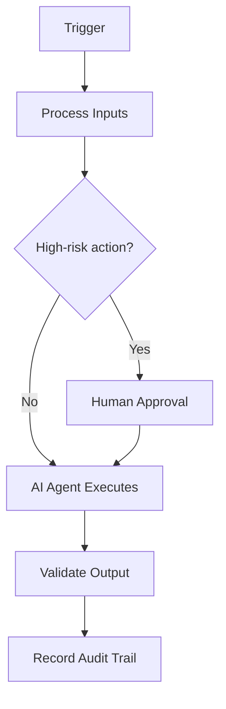

# Profiles

> **Navigate:** [Home](../../../README.md) · [Catalogue](../../../ROOT_INDEX.md) · [Generated Index](../../README.md) · [Phase 16 Prompt](../../../01_PHASES/PHASE_16_AIBOS_SDK_CLI_MASTER_PROMPT.md)

## Executive Summary

This document defines **Profiles** within the AIBOS Enterprise v2.0 framework (Phase 16). It inherits every root standard and is designed to be enterprise-ready, machine-readable and AI-friendly.

## Purpose

To establish the authoritative, reusable definition of Profiles so that human teams and AI agents operate consistently, safely and with measurable business value.

## Scope

Applies across the AIBOS enterprise and is inherited by all dependent artefacts. Concerns owned elsewhere are delegated to their owning documents to avoid duplication.

## Business Value

Reduced duplication, faster safe delivery, improved compliance posture and scalable AI augmentation.

## Developer Value

This section (Developer Value) for **Profiles** is defined in line with the AIBOS root standards and the governing Phase 16 master prompt. See the [repository catalogue](../../../ROOT_INDEX.md) and the [root standards](../../../00_ROOT) for related material.

## Functional Requirements

This section (Functional Requirements) for **Profiles** is defined in line with the AIBOS root standards and the governing Phase 16 master prompt. See the [repository catalogue](../../../ROOT_INDEX.md) and the [root standards](../../../00_ROOT) for related material.

## Non-functional Requirements

This section (Non-functional Requirements) for **Profiles** is defined in line with the AIBOS root standards and the governing Phase 16 master prompt. See the [repository catalogue](../../../ROOT_INDEX.md) and the [root standards](../../../00_ROOT) for related material.

## Public Interfaces

This section (Public Interfaces) for **Profiles** is defined in line with the AIBOS root standards and the governing Phase 16 master prompt. See the [repository catalogue](../../../ROOT_INDEX.md) and the [root standards](../../../00_ROOT) for related material.

## Commands/APIs

This section (Commands/APIs) for **Profiles** is defined in line with the AIBOS root standards and the governing Phase 16 master prompt. See the [repository catalogue](../../../ROOT_INDEX.md) and the [root standards](../../../00_ROOT) for related material.

## Configuration Model

This section (Configuration Model) for **Profiles** is defined in line with the AIBOS root standards and the governing Phase 16 master prompt. See the [repository catalogue](../../../ROOT_INDEX.md) and the [root standards](../../../00_ROOT) for related material.

## Authentication

This section (Authentication) for **Profiles** is defined in line with the AIBOS root standards and the governing Phase 16 master prompt. See the [repository catalogue](../../../ROOT_INDEX.md) and the [root standards](../../../00_ROOT) for related material.

## Authorisation

This section (Authorisation) for **Profiles** is defined in line with the AIBOS root standards and the governing Phase 16 master prompt. See the [repository catalogue](../../../ROOT_INDEX.md) and the [root standards](../../../00_ROOT) for related material.

## Extension Points

This section (Extension Points) for **Profiles** is defined in line with the AIBOS root standards and the governing Phase 16 master prompt. See the [repository catalogue](../../../ROOT_INDEX.md) and the [root standards](../../../00_ROOT) for related material.

## Plugin Architecture

This section (Plugin Architecture) for **Profiles** is defined in line with the AIBOS root standards and the governing Phase 16 master prompt. See the [repository catalogue](../../../ROOT_INDEX.md) and the [root standards](../../../00_ROOT) for related material.

## Versioning Strategy

This section (Versioning Strategy) for **Profiles** is defined in line with the AIBOS root standards and the governing Phase 16 master prompt. See the [repository catalogue](../../../ROOT_INDEX.md) and the [root standards](../../../00_ROOT) for related material.

## Backward Compatibility

This section (Backward Compatibility) for **Profiles** is defined in line with the AIBOS root standards and the governing Phase 16 master prompt. See the [repository catalogue](../../../ROOT_INDEX.md) and the [root standards](../../../00_ROOT) for related material.

## Error Handling

This section (Error Handling) for **Profiles** is defined in line with the AIBOS root standards and the governing Phase 16 master prompt. See the [repository catalogue](../../../ROOT_INDEX.md) and the [root standards](../../../00_ROOT) for related material.

## Observability

This section (Observability) for **Profiles** is defined in line with the AIBOS root standards and the governing Phase 16 master prompt. See the [repository catalogue](../../../ROOT_INDEX.md) and the [root standards](../../../00_ROOT) for related material.

## Security Controls

- Authentication and authorisation enforced.
- Encryption in transit and at rest.
- Audit logging and continuous monitoring.

## Privacy Controls

- Data minimisation.
- Purpose limitation.
- Retention and secure-deletion policies.

## Performance Targets

This section (Performance Targets) for **Profiles** is defined in line with the AIBOS root standards and the governing Phase 16 master prompt. See the [repository catalogue](../../../ROOT_INDEX.md) and the [root standards](../../../00_ROOT) for related material.

## Testing Strategy

This section (Testing Strategy) for **Profiles** is defined in line with the AIBOS root standards and the governing Phase 16 master prompt. See the [repository catalogue](../../../ROOT_INDEX.md) and the [root standards](../../../00_ROOT) for related material.

## CI/CD Integration

This section (CI/CD Integration) for **Profiles** is defined in line with the AIBOS root standards and the governing Phase 16 master prompt. See the [repository catalogue](../../../ROOT_INDEX.md) and the [root standards](../../../00_ROOT) for related material.

## Required Skills

- See **[Specialist Skills (Phase 05)](../../PHASE_05_SKILLS/README.md)** for the relevant artefacts.
- Inherited standards: [AIBOS Root Specification](../../../00_ROOT/AIBOS_ROOT_SPECIFICATION.md).
- Full catalogue: [ROOT_INDEX](../../../ROOT_INDEX.md).

## Required Rules

- See **[Enterprise Rules (Phase 06)](../../PHASE_06_RULES/README.md)** for the relevant artefacts.
- Inherited standards: [AIBOS Root Specification](../../../00_ROOT/AIBOS_ROOT_SPECIFICATION.md).
- Full catalogue: [ROOT_INDEX](../../../ROOT_INDEX.md).

## Required Checklists

- See **[Enterprise Checklists (Phase 07)](../../PHASE_07_CHECKLISTS/README.md)** for the relevant artefacts.
- Inherited standards: [AIBOS Root Specification](../../../00_ROOT/AIBOS_ROOT_SPECIFICATION.md).
- Full catalogue: [ROOT_INDEX](../../../ROOT_INDEX.md).

## Required Playbooks

- See **[Enterprise Playbooks (Phase 08)](../../PHASE_08_PLAYBOOKS/README.md)** for the relevant artefacts.
- Inherited standards: [AIBOS Root Specification](../../../00_ROOT/AIBOS_ROOT_SPECIFICATION.md).
- Full catalogue: [ROOT_INDEX](../../../ROOT_INDEX.md).

## Required Templates

- See **[Enterprise Templates (Phase 09)](../../PHASE_09_TEMPLATES/README.md)** for the relevant artefacts.
- Inherited standards: [AIBOS Root Specification](../../../00_ROOT/AIBOS_ROOT_SPECIFICATION.md).
- Full catalogue: [ROOT_INDEX](../../../ROOT_INDEX.md).

## Required Knowledge

- See **[Enterprise Knowledge (Phase 10)](../../PHASE_10_KNOWLEDGE/README.md)** for the relevant artefacts.
- Inherited standards: [AIBOS Root Specification](../../../00_ROOT/AIBOS_ROOT_SPECIFICATION.md).
- Full catalogue: [ROOT_INDEX](../../../ROOT_INDEX.md).

## Sample Usage

```yaml
# Example for: Profiles
name: example
version: 2.0.0
status: draft
```

## Mermaid Diagrams



## Validation Checklist

- [ ] YAML front matter is present and valid.
- [ ] All mandatory sections are complete.
- [ ] Terminology matches the AIBOS Enterprise Glossary.
- [ ] Cross-references resolve to existing documents.
- [ ] RFC 2119 keywords are used correctly.
- [ ] Security and privacy considerations are addressed.
- [ ] Version history is updated.
- [ ] No secrets or sensitive data are exposed.

## References

- [AIBOS Root Specification](../../../00_ROOT/AIBOS_ROOT_SPECIFICATION.md)
- [Enterprise Glossary](../../../00_ROOT/AIBOS_ENTERPRISE_GLOSSARY.md)
- [Document Schema](../../../00_ROOT/AIBOS_DOCUMENT_SCHEMA.md)
- [Repository Catalogue (ROOT_INDEX)](../../../ROOT_INDEX.md)
- [Phase 16 Master Prompt](../../../01_PHASES/PHASE_16_AIBOS_SDK_CLI_MASTER_PROMPT.md)

## Version History

| Version | Date | Summary |
| --- | --- | --- |
| 2.0.0 | 2026-06-26 | Initial generated artefact. |
