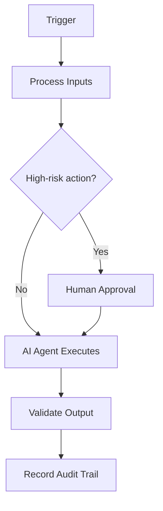

# Pre-commit Hooks

## Executive Summary

This document defines **Pre-commit Hooks** within the AIBOS Enterprise v2.0 framework (Phase 16). It inherits every root standard and is designed to be enterprise-ready, machine-readable and AI-friendly.

## Purpose

To establish the authoritative, reusable definition of Pre-commit Hooks so that human teams and AI agents operate consistently, safely and with measurable business value.

## Scope

Applies across the AIBOS enterprise and is inherited by all dependent artefacts. Concerns owned elsewhere are delegated to their owning documents to avoid duplication.

## Business Value

Reduced duplication, faster safe delivery, improved compliance posture and scalable AI augmentation.

## Developer Value

This section (Developer Value) for **Pre-commit Hooks** is defined in line with the AIBOS root standards and the governing Phase 16 master prompt. See `ROOT_INDEX.md` for related artefacts and `00_ROOT/` for the inherited standards.

## Functional Requirements

This section (Functional Requirements) for **Pre-commit Hooks** is defined in line with the AIBOS root standards and the governing Phase 16 master prompt. See `ROOT_INDEX.md` for related artefacts and `00_ROOT/` for the inherited standards.

## Non-functional Requirements

This section (Non-functional Requirements) for **Pre-commit Hooks** is defined in line with the AIBOS root standards and the governing Phase 16 master prompt. See `ROOT_INDEX.md` for related artefacts and `00_ROOT/` for the inherited standards.

## Public Interfaces

This section (Public Interfaces) for **Pre-commit Hooks** is defined in line with the AIBOS root standards and the governing Phase 16 master prompt. See `ROOT_INDEX.md` for related artefacts and `00_ROOT/` for the inherited standards.

## Commands/APIs

This section (Commands/APIs) for **Pre-commit Hooks** is defined in line with the AIBOS root standards and the governing Phase 16 master prompt. See `ROOT_INDEX.md` for related artefacts and `00_ROOT/` for the inherited standards.

## Configuration Model

This section (Configuration Model) for **Pre-commit Hooks** is defined in line with the AIBOS root standards and the governing Phase 16 master prompt. See `ROOT_INDEX.md` for related artefacts and `00_ROOT/` for the inherited standards.

## Authentication

This section (Authentication) for **Pre-commit Hooks** is defined in line with the AIBOS root standards and the governing Phase 16 master prompt. See `ROOT_INDEX.md` for related artefacts and `00_ROOT/` for the inherited standards.

## Authorisation

This section (Authorisation) for **Pre-commit Hooks** is defined in line with the AIBOS root standards and the governing Phase 16 master prompt. See `ROOT_INDEX.md` for related artefacts and `00_ROOT/` for the inherited standards.

## Extension Points

This section (Extension Points) for **Pre-commit Hooks** is defined in line with the AIBOS root standards and the governing Phase 16 master prompt. See `ROOT_INDEX.md` for related artefacts and `00_ROOT/` for the inherited standards.

## Plugin Architecture

This section (Plugin Architecture) for **Pre-commit Hooks** is defined in line with the AIBOS root standards and the governing Phase 16 master prompt. See `ROOT_INDEX.md` for related artefacts and `00_ROOT/` for the inherited standards.

## Versioning Strategy

This section (Versioning Strategy) for **Pre-commit Hooks** is defined in line with the AIBOS root standards and the governing Phase 16 master prompt. See `ROOT_INDEX.md` for related artefacts and `00_ROOT/` for the inherited standards.

## Backward Compatibility

This section (Backward Compatibility) for **Pre-commit Hooks** is defined in line with the AIBOS root standards and the governing Phase 16 master prompt. See `ROOT_INDEX.md` for related artefacts and `00_ROOT/` for the inherited standards.

## Error Handling

This section (Error Handling) for **Pre-commit Hooks** is defined in line with the AIBOS root standards and the governing Phase 16 master prompt. See `ROOT_INDEX.md` for related artefacts and `00_ROOT/` for the inherited standards.

## Observability

This section (Observability) for **Pre-commit Hooks** is defined in line with the AIBOS root standards and the governing Phase 16 master prompt. See `ROOT_INDEX.md` for related artefacts and `00_ROOT/` for the inherited standards.

## Security Controls

- Authentication and authorisation enforced.
- Encryption in transit and at rest.
- Audit logging and monitoring.

## Privacy Controls

- Data minimisation.
- Purpose limitation.
- Retention and secure deletion policies.

## Performance Targets

- Coverage and completeness of the artefact.
- Validation pass rate (target 95%+).
- Cycle time from draft to approval.
- Reuse rate across the enterprise.

## Testing Strategy

This section (Testing Strategy) for **Pre-commit Hooks** is defined in line with the AIBOS root standards and the governing Phase 16 master prompt. See `ROOT_INDEX.md` for related artefacts and `00_ROOT/` for the inherited standards.

## CI/CD Integration

This section (CI/CD Integration) for **Pre-commit Hooks** is defined in line with the AIBOS root standards and the governing Phase 16 master prompt. See `ROOT_INDEX.md` for related artefacts and `00_ROOT/` for the inherited standards.

## Required Skills

- Inherits all root standards under `00_ROOT/`.
- Cross-references the relevant Phase artefacts under `02_ARTEFACTS/`.
- See `ROOT_INDEX.md` for the full catalogue.

## Required Rules

- Inherits all root standards under `00_ROOT/`.
- Cross-references the relevant Phase artefacts under `02_ARTEFACTS/`.
- See `ROOT_INDEX.md` for the full catalogue.

## Required Checklists

- Inherits all root standards under `00_ROOT/`.
- Cross-references the relevant Phase artefacts under `02_ARTEFACTS/`.
- See `ROOT_INDEX.md` for the full catalogue.

## Required Playbooks

- Inherits all root standards under `00_ROOT/`.
- Cross-references the relevant Phase artefacts under `02_ARTEFACTS/`.
- See `ROOT_INDEX.md` for the full catalogue.

## Required Templates

- Inherits all root standards under `00_ROOT/`.
- Cross-references the relevant Phase artefacts under `02_ARTEFACTS/`.
- See `ROOT_INDEX.md` for the full catalogue.

## Required Knowledge

- Inherits all root standards under `00_ROOT/`.
- Cross-references the relevant Phase artefacts under `02_ARTEFACTS/`.
- See `ROOT_INDEX.md` for the full catalogue.

## Sample Usage

```yaml
# Example for: Pre-commit Hooks
name: example
version: 2.0.0
status: draft
```

## Mermaid Diagrams



## Validation Checklist

- [ ] YAML front matter is present and valid.
- [ ] All mandatory sections are complete.
- [ ] Terminology matches the AIBOS Enterprise Glossary.
- [ ] Cross-references resolve to existing documents.
- [ ] RFC 2119 keywords are used correctly.
- [ ] Security and privacy considerations are addressed.
- [ ] Version history is updated.
- [ ] No secrets or sensitive data are exposed.

## References

This section (References) for **Pre-commit Hooks** is defined in line with the AIBOS root standards and the governing Phase 16 master prompt. See `ROOT_INDEX.md` for related artefacts and `00_ROOT/` for the inherited standards.

## Version History

| Version | Date | Summary |
| --- | --- | --- |
| 2.0.0 | 2026-06-26 | Initial generated artefact. |
