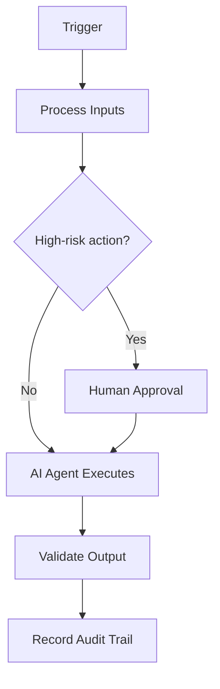

# DevSecOps

## Executive Summary

This document defines **DevSecOps** within the AIBOS Enterprise v2.0 framework (Phase 19). It inherits every root standard and is designed to be enterprise-ready, machine-readable and AI-friendly.

## Purpose

To establish the authoritative, reusable definition of DevSecOps so that human teams and AI agents operate consistently, safely and with measurable business value.

## Scope

Applies across the AIBOS enterprise and is inherited by all dependent artefacts. Concerns owned elsewhere are delegated to their owning documents to avoid duplication.

## Organisational Context

This section (Organisational Context) for **DevSecOps** is defined in line with the AIBOS root standards and the governing Phase 19 master prompt. See `ROOT_INDEX.md` for related artefacts and `00_ROOT/` for the inherited standards.

## Business Model

This section (Business Model) for **DevSecOps** is defined in line with the AIBOS root standards and the governing Phase 19 master prompt. See `ROOT_INDEX.md` for related artefacts and `00_ROOT/` for the inherited standards.

## Organisation Chart

This section (Organisation Chart) for **DevSecOps** is defined in line with the AIBOS root standards and the governing Phase 19 master prompt. See `ROOT_INDEX.md` for related artefacts and `00_ROOT/` for the inherited standards.

## Mermaid Diagrams

## Team Structure

This section (Team Structure) for **DevSecOps** is defined in line with the AIBOS root standards and the governing Phase 19 master prompt. See `ROOT_INDEX.md` for related artefacts and `00_ROOT/` for the inherited standards.

## AI Agent Structure

This section (AI Agent Structure) for **DevSecOps** is defined in line with the AIBOS root standards and the governing Phase 19 master prompt. See `ROOT_INDEX.md` for related artefacts and `00_ROOT/` for the inherited standards.

## Roles and Responsibilities

This section (Roles and Responsibilities) for **DevSecOps** is defined in line with the AIBOS root standards and the governing Phase 19 master prompt. See `ROOT_INDEX.md` for related artefacts and `00_ROOT/` for the inherited standards.

## RACI

| Activity | Responsible | Accountable | Consulted | Informed |
| --- | --- | --- | --- | --- |
| Primary task | Specialist | Department Lead | Architecture | Stakeholders |

## Governance

This section (Governance) for **DevSecOps** is defined in line with the AIBOS root standards and the governing Phase 19 master prompt. See `ROOT_INDEX.md` for related artefacts and `00_ROOT/` for the inherited standards.

## Decision Matrix

| Partner | Interaction | Direction |
| --- | --- | --- |
| Upstream owners | Provide inputs | Inbound |
| Downstream consumers | Consume outputs | Outbound |
| Governance | Review and approve | Bidirectional |

## Escalation Model

This section (Escalation Model) for **DevSecOps** is defined in line with the AIBOS root standards and the governing Phase 19 master prompt. See `ROOT_INDEX.md` for related artefacts and `00_ROOT/` for the inherited standards.

## Skills Mapping

- Inherits all root standards under `00_ROOT/`.
- Cross-references the relevant Phase artefacts under `02_ARTEFACTS/`.
- See `ROOT_INDEX.md` for the full catalogue.

## Rules Mapping

- Inherits all root standards under `00_ROOT/`.
- Cross-references the relevant Phase artefacts under `02_ARTEFACTS/`.
- See `ROOT_INDEX.md` for the full catalogue.

## Checklists Mapping

- Inherits all root standards under `00_ROOT/`.
- Cross-references the relevant Phase artefacts under `02_ARTEFACTS/`.
- See `ROOT_INDEX.md` for the full catalogue.

## Playbooks Mapping

- Inherits all root standards under `00_ROOT/`.
- Cross-references the relevant Phase artefacts under `02_ARTEFACTS/`.
- See `ROOT_INDEX.md` for the full catalogue.

## Templates Mapping

- Inherits all root standards under `00_ROOT/`.
- Cross-references the relevant Phase artefacts under `02_ARTEFACTS/`.
- See `ROOT_INDEX.md` for the full catalogue.

## Knowledge Mapping

- Inherits all root standards under `00_ROOT/`.
- Cross-references the relevant Phase artefacts under `02_ARTEFACTS/`.
- See `ROOT_INDEX.md` for the full catalogue.

## Automation Mapping

- Inherits all root standards under `00_ROOT/`.
- Cross-references the relevant Phase artefacts under `02_ARTEFACTS/`.
- See `ROOT_INDEX.md` for the full catalogue.

## Marketplace Assets

This section (Marketplace Assets) for **DevSecOps** is defined in line with the AIBOS root standards and the governing Phase 19 master prompt. See `ROOT_INDEX.md` for related artefacts and `00_ROOT/` for the inherited standards.

## SDK Usage

This section (SDK Usage) for **DevSecOps** is defined in line with the AIBOS root standards and the governing Phase 19 master prompt. See `ROOT_INDEX.md` for related artefacts and `00_ROOT/` for the inherited standards.

## CI/CD Integration

This section (CI/CD Integration) for **DevSecOps** is defined in line with the AIBOS root standards and the governing Phase 19 master prompt. See `ROOT_INDEX.md` for related artefacts and `00_ROOT/` for the inherited standards.

## Security Controls

- Authentication and authorisation enforced.
- Encryption in transit and at rest.
- Audit logging and monitoring.

## Compliance Controls

| Standard | Application |
| --- | --- |
| ISO 42001 | AI management system alignment. |
| ISO 27001 | Information security controls. |
| NIST AI RMF | AI risk management. |
| OWASP LLM Top 10 | LLM threat mitigation. |

## KPIs

- Coverage and completeness of the artefact.
- Validation pass rate (target 95%+).
- Cycle time from draft to approval.
- Reuse rate across the enterprise.

## OKRs

- Coverage and completeness of the artefact.
- Validation pass rate (target 95%+).
- Cycle time from draft to approval.
- Reuse rate across the enterprise.

## Dashboards

This section (Dashboards) for **DevSecOps** is defined in line with the AIBOS root standards and the governing Phase 19 master prompt. See `ROOT_INDEX.md` for related artefacts and `00_ROOT/` for the inherited standards.

## Risks

- Scope drift over time.
- Inconsistent adoption across teams.
- Over-automation without adequate oversight.

## Continuous Improvement

This section (Continuous Improvement) for **DevSecOps** is defined in line with the AIBOS root standards and the governing Phase 19 master prompt. See `ROOT_INDEX.md` for related artefacts and `00_ROOT/` for the inherited standards.

## Validation Checklist

- [ ] YAML front matter is present and valid.
- [ ] All mandatory sections are complete.
- [ ] Terminology matches the AIBOS Enterprise Glossary.
- [ ] Cross-references resolve to existing documents.
- [ ] RFC 2119 keywords are used correctly.
- [ ] Security and privacy considerations are addressed.
- [ ] Version history is updated.
- [ ] No secrets or sensitive data are exposed.

## References

This section (References) for **DevSecOps** is defined in line with the AIBOS root standards and the governing Phase 19 master prompt. See `ROOT_INDEX.md` for related artefacts and `00_ROOT/` for the inherited standards.

## Version History

| Version | Date | Summary |
| --- | --- | --- |
| 2.0.0 | 2026-06-26 | Initial generated artefact. |
