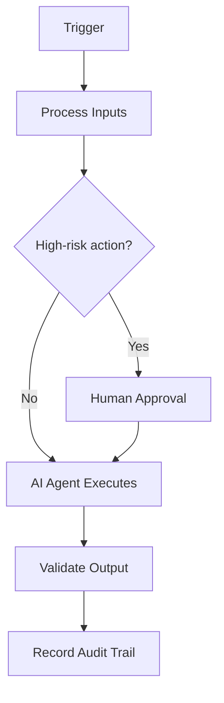

# CI/CD

> **Navigate:** [Home](../../../README.md) · [Catalogue](../../../ROOT_INDEX.md) · [Generated Index](../../README.md) · [Phase 19 Prompt](../../../01_PHASES/PHASE_19_AIBOS_REFERENCE_AI_ORGANISATION_MASTER_PROMPT.md)

## Executive Summary

This document defines **CI/CD** within the AIBOS Enterprise v2.0 framework (Phase 19). It inherits every root standard and is designed to be enterprise-ready, machine-readable and AI-friendly.

## Purpose

To establish the authoritative, reusable definition of CI/CD so that human teams and AI agents operate consistently, safely and with measurable business value.

## Scope

Applies across the AIBOS enterprise and is inherited by all dependent artefacts. Concerns owned elsewhere are delegated to their owning documents to avoid duplication.

## Organisational Context

- Cross-functional teams aligned to value streams.
- Clear ownership, RACI and decision rights.
- A centre of excellence sets standards; teams deliver.
- Human roles augmented by AI agents under oversight.

## Business Model

- Clear value proposition and target customers.
- Pricing aligned to a value metric.
- Cost structure and margin understood.
- Growth and retention levers identified.

## Organisation Chart

- Cross-functional teams aligned to value streams.
- Clear ownership, RACI and decision rights.
- A centre of excellence sets standards; teams deliver.
- Human roles augmented by AI agents under oversight.

## Mermaid Diagrams

## Team Structure

- Cross-functional teams aligned to value streams.
- Clear ownership, RACI and decision rights.
- A centre of excellence sets standards; teams deliver.
- Human roles augmented by AI agents under oversight.

## AI Agent Structure

| Agent | Role | Authority | Human Approval |
| --- | --- | --- | --- |
| Orchestrator | Plans and delegates | Coordinate | For high-risk plans |
| Specialist agents | Execute scoped tasks | Least-privilege | For risky actions |
| Reviewer agent | Validates outputs | Read/assess | N/A |

## Roles and Responsibilities

- Owner — accountable for this artefact/workflow.
- Contributors — execute within their authority (human or AI).
- Reviewers/Approvers — validate and sign off.
- Governance — oversee risk, security and compliance.

## RACI

| Activity | Responsible | Accountable | Consulted | Informed |
| --- | --- | --- | --- | --- |
| Primary task | Specialist | Department Lead | Architecture | Stakeholders |

## Governance

- Risk-tiered oversight aligned to ISO 42001 and NIST AI RMF.
- Human-in-the-loop for high-impact decisions.
- Audit trails, evaluation gates and model documentation.
- Clear ownership, approval and escalation paths.

## Decision Matrix

| Partner | Interaction | Direction |
| --- | --- | --- |
| Upstream owners | Provide inputs | Inbound |
| Downstream consumers | Consume outputs | Outbound |
| Governance | Review and approve | Bidirectional |

## Escalation Model

- Owner -> domain lead -> Governance Division.
- Severity-based timelines for response.
- Clear hand-off with full context and audit trail.

## Skills Mapping

- See **[Specialist Skills (Phase 05)](../../PHASE_05_SKILLS/README.md)** for the relevant artefacts.
- Inherited standards: [AIBOS Root Specification](../../../00_ROOT/AIBOS_ROOT_SPECIFICATION.md).
- Full catalogue: [ROOT_INDEX](../../../ROOT_INDEX.md).

## Rules Mapping

- See **[Enterprise Rules (Phase 06)](../../PHASE_06_RULES/README.md)** for the relevant artefacts.
- Inherited standards: [AIBOS Root Specification](../../../00_ROOT/AIBOS_ROOT_SPECIFICATION.md).
- Full catalogue: [ROOT_INDEX](../../../ROOT_INDEX.md).

## Checklists Mapping

- See **[Enterprise Checklists (Phase 07)](../../PHASE_07_CHECKLISTS/README.md)** for the relevant artefacts.
- Inherited standards: [AIBOS Root Specification](../../../00_ROOT/AIBOS_ROOT_SPECIFICATION.md).
- Full catalogue: [ROOT_INDEX](../../../ROOT_INDEX.md).

## Playbooks Mapping

- See **[Enterprise Playbooks (Phase 08)](../../PHASE_08_PLAYBOOKS/README.md)** for the relevant artefacts.
- Inherited standards: [AIBOS Root Specification](../../../00_ROOT/AIBOS_ROOT_SPECIFICATION.md).
- Full catalogue: [ROOT_INDEX](../../../ROOT_INDEX.md).

## Templates Mapping

- See **[Enterprise Templates (Phase 09)](../../PHASE_09_TEMPLATES/README.md)** for the relevant artefacts.
- Inherited standards: [AIBOS Root Specification](../../../00_ROOT/AIBOS_ROOT_SPECIFICATION.md).
- Full catalogue: [ROOT_INDEX](../../../ROOT_INDEX.md).

## Knowledge Mapping

- See **[Enterprise Knowledge (Phase 10)](../../PHASE_10_KNOWLEDGE/README.md)** for the relevant artefacts.
- Inherited standards: [AIBOS Root Specification](../../../00_ROOT/AIBOS_ROOT_SPECIFICATION.md).
- Full catalogue: [ROOT_INDEX](../../../ROOT_INDEX.md).

## Automation Mapping

- See **[Enterprise Automation (Phase 12)](../../PHASE_12_AUTOMATION/README.md)** for the relevant artefacts.
- Inherited standards: [AIBOS Root Specification](../../../00_ROOT/AIBOS_ROOT_SPECIFICATION.md).
- Full catalogue: [ROOT_INDEX](../../../ROOT_INDEX.md).

## Marketplace Assets

- See **[Marketplace (Phase 18)](../../PHASE_18_MARKETPLACE/README.md)** for the relevant artefacts.
- Inherited standards: [AIBOS Root Specification](../../../00_ROOT/AIBOS_ROOT_SPECIFICATION.md).
- Full catalogue: [ROOT_INDEX](../../../ROOT_INDEX.md).

## SDK Usage

- See **[SDK and CLI (Phase 16)](../../PHASE_16_SDK_CLI/README.md)** for the relevant artefacts.
- Inherited standards: [AIBOS Root Specification](../../../00_ROOT/AIBOS_ROOT_SPECIFICATION.md).
- Full catalogue: [ROOT_INDEX](../../../ROOT_INDEX.md).

## CI/CD Integration

- Event-driven integration with idempotent consumers.
- Governed APIs (OpenAPI) and MCP tools for system access.
- Retry, back-off and dead-letter handling for resilience.
- Monitoring and alerting on every integration.

## Security Controls

- Authentication and authorisation enforced.
- Encryption in transit and at rest.
- Audit logging and continuous monitoring.

## Compliance Controls

| Standard | Application |
| --- | --- |
| ISO 42001 | AI management system alignment. |
| ISO 27001 | Information security controls. |
| NIST AI RMF | AI risk management. |
| OWASP LLM Top 10 | LLM threat mitigation. |

## KPIs

- Coverage and completeness.
- Validation pass rate (target 95%+).
- Cycle time from draft to approval.
- Reuse rate across the enterprise.

## OKRs

- Objective: raise enterprise consistency.
- Key result: 95%+ validation pass rate.
- Key result: measurable reuse across teams.

## Dashboards

- Executive view of outcomes and KPIs.
- Operational view of health and throughput.
- Governance view of risk, security and compliance.

## Risks

- Scope drift over time.
- Inconsistent adoption across teams.
- Over-automation without adequate oversight.

## Continuous Improvement

- Capture metrics, incidents and feedback.
- Review on a regular cadence and prioritise improvements.
- Update artefacts and re-measure the impact.

## Validation Checklist

- [ ] YAML front matter is present and valid.
- [ ] All mandatory sections are complete.
- [ ] Terminology matches the AIBOS Enterprise Glossary.
- [ ] Cross-references resolve to existing documents.
- [ ] RFC 2119 keywords are used correctly.
- [ ] Security and privacy considerations are addressed.
- [ ] Version history is updated.
- [ ] No secrets or sensitive data are exposed.

## References

- [AIBOS Root Specification](../../../00_ROOT/AIBOS_ROOT_SPECIFICATION.md)
- [Enterprise Glossary](../../../00_ROOT/AIBOS_ENTERPRISE_GLOSSARY.md)
- [Document Schema](../../../00_ROOT/AIBOS_DOCUMENT_SCHEMA.md)
- [Repository Catalogue (ROOT_INDEX)](../../../ROOT_INDEX.md)
- [Phase 19 Master Prompt](../../../01_PHASES/PHASE_19_AIBOS_REFERENCE_AI_ORGANISATION_MASTER_PROMPT.md)

## Version History

| Version | Date | Summary |
| --- | --- | --- |
| 2.0.0 | 2026-06-26 | Initial generated artefact. |
