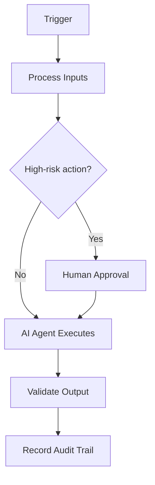

# Task Planning

> **Navigate:** [Home](../../../README.md) · [Catalogue](../../../ROOT_INDEX.md) · [Generated Index](../../README.md) · [Phase 20 Prompt](../../../01_PHASES/PHASE_20_AIBOS_META_ORCHESTRATOR_AUTONOMOUS_ENTERPRISE_MASTER_PROMPT.md)

## Executive Summary

This document defines **Task Planning** within the AIBOS Enterprise v2.0 framework (Phase 20). It inherits every root standard and is designed to be enterprise-ready, machine-readable and AI-friendly.

## Purpose

To establish the authoritative, reusable definition of Task Planning so that human teams and AI agents operate consistently, safely and with measurable business value.

## Scope

Applies across the AIBOS enterprise and is inherited by all dependent artefacts. Concerns owned elsewhere are delegated to their owning documents to avoid duplication.

## Business Value

Reduced duplication, faster safe delivery, improved compliance posture and scalable AI augmentation.

## Responsibilities

- Own and maintain this artefact.
- Ensure alignment with the root standards.
- Validate outputs before publication.

## Inputs

- The request/context that initiated the work.
- Relevant data, artefacts and configuration.
- Applicable rules, standards and prior decisions.

## Outputs

- The validated result of the work.
- Evidence and an audit trail.
- Follow-up actions and updated cross-references.

## Decision Logic

- Decisions are explicit, explainable and auditable.
- High-risk or ambiguous cases route to humans.
- Logic is versioned and tested.

## Human Approval Gates

- Required before any irreversible or high-risk action.
- Required before external or customer-facing communications.
- Required before financial or regulated decisions.
- Captured with identity, timestamp and rationale.

## AI Agents Involved

- See **[AI Agent Collaboration (Phase 11)](../../PHASE_11_AI_AGENT_COLLABORATION/README.md)** for the relevant artefacts.
- Inherited standards: [AIBOS Root Specification](../../../00_ROOT/AIBOS_ROOT_SPECIFICATION.md).
- Full catalogue: [ROOT_INDEX](../../../ROOT_INDEX.md).

## Memory Strategy

- Short-term working context for the active task.
- Governed long-term memory for reuse, with access control.
- Provenance and freshness tracked for grounding.

## Context Strategy

- Ground responses in approved, current sources (RAG).
- Manage short-term working context and long-term memory.
- Track provenance and freshness; enforce access control.

## Governance Model

- Risk-tiered oversight aligned to ISO 42001 and NIST AI RMF.
- Human-in-the-loop for high-impact decisions.
- Audit trails, evaluation gates and model documentation.
- Clear ownership, approval and escalation paths.

## Security Controls

- Authentication and authorisation enforced.
- Encryption in transit and at rest.
- Audit logging and continuous monitoring.

## Privacy Controls

- Data minimisation.
- Purpose limitation.
- Retention and secure-deletion policies.

## Compliance Mapping

| Standard | Application |
| --- | --- |
| ISO 42001 | AI management system alignment. |
| ISO 27001 | Information security controls. |
| NIST AI RMF | AI risk management. |
| OWASP LLM Top 10 | LLM threat mitigation. |

## Tool Integrations

- Event-driven integration with idempotent consumers.
- Governed APIs (OpenAPI) and MCP tools for system access.
- Retry, back-off and dead-letter handling for resilience.
- Monitoring and alerting on every integration.

## Event Triggers

- A request or task is submitted.
- A scheduled cycle or threshold is reached.
- An upstream event or signal is received.

## KPIs

- Coverage and completeness.
- Validation pass rate (target 95%+).
- Cycle time from draft to approval.
- Reuse rate across the enterprise.

## SLOs

- Availability and latency targets defined per service.
- Error budgets tracked and reviewed.

## Error Recovery

- Detect, capture and classify the error with context.
- Apply a safe fallback or stop safely.
- Retry idempotently where safe; otherwise escalate.
- Open an incident if customer impact is possible.

## Escalation Strategy

- Owner -> domain lead -> Governance Division.
- Severity-based timelines for response.
- Clear hand-off with full context and audit trail.

## Continuous Improvement Loop

- Capture metrics, incidents and feedback.
- Review on a regular cadence and prioritise improvements.
- Update artefacts and re-measure the impact.

## Related Skills

- See **[Specialist Skills (Phase 05)](../../PHASE_05_SKILLS/README.md)** for the relevant artefacts.
- Inherited standards: [AIBOS Root Specification](../../../00_ROOT/AIBOS_ROOT_SPECIFICATION.md).
- Full catalogue: [ROOT_INDEX](../../../ROOT_INDEX.md).

## Related Rules

- See **[Enterprise Rules (Phase 06)](../../PHASE_06_RULES/README.md)** for the relevant artefacts.
- Inherited standards: [AIBOS Root Specification](../../../00_ROOT/AIBOS_ROOT_SPECIFICATION.md).
- Full catalogue: [ROOT_INDEX](../../../ROOT_INDEX.md).

## Related Checklists

- See **[Enterprise Checklists (Phase 07)](../../PHASE_07_CHECKLISTS/README.md)** for the relevant artefacts.
- Inherited standards: [AIBOS Root Specification](../../../00_ROOT/AIBOS_ROOT_SPECIFICATION.md).
- Full catalogue: [ROOT_INDEX](../../../ROOT_INDEX.md).

## Related Playbooks

- See **[Enterprise Playbooks (Phase 08)](../../PHASE_08_PLAYBOOKS/README.md)** for the relevant artefacts.
- Inherited standards: [AIBOS Root Specification](../../../00_ROOT/AIBOS_ROOT_SPECIFICATION.md).
- Full catalogue: [ROOT_INDEX](../../../ROOT_INDEX.md).

## Related Templates

- See **[Enterprise Templates (Phase 09)](../../PHASE_09_TEMPLATES/README.md)** for the relevant artefacts.
- Inherited standards: [AIBOS Root Specification](../../../00_ROOT/AIBOS_ROOT_SPECIFICATION.md).
- Full catalogue: [ROOT_INDEX](../../../ROOT_INDEX.md).

## Related Knowledge

- See **[Enterprise Knowledge (Phase 10)](../../PHASE_10_KNOWLEDGE/README.md)** for the relevant artefacts.
- Inherited standards: [AIBOS Root Specification](../../../00_ROOT/AIBOS_ROOT_SPECIFICATION.md).
- Full catalogue: [ROOT_INDEX](../../../ROOT_INDEX.md).

## Mermaid Diagrams

## Validation Checklist

- [ ] YAML front matter is present and valid.
- [ ] All mandatory sections are complete.
- [ ] Terminology matches the AIBOS Enterprise Glossary.
- [ ] Cross-references resolve to existing documents.
- [ ] RFC 2119 keywords are used correctly.
- [ ] Security and privacy considerations are addressed.
- [ ] Version history is updated.
- [ ] No secrets or sensitive data are exposed.

## References

- [AIBOS Root Specification](../../../00_ROOT/AIBOS_ROOT_SPECIFICATION.md)
- [Enterprise Glossary](../../../00_ROOT/AIBOS_ENTERPRISE_GLOSSARY.md)
- [Document Schema](../../../00_ROOT/AIBOS_DOCUMENT_SCHEMA.md)
- [Repository Catalogue (ROOT_INDEX)](../../../ROOT_INDEX.md)
- [Phase 20 Master Prompt](../../../01_PHASES/PHASE_20_AIBOS_META_ORCHESTRATOR_AUTONOMOUS_ENTERPRISE_MASTER_PROMPT.md)

## Version History

| Version | Date | Summary |
| --- | --- | --- |
| 2.0.0 | 2026-06-26 | Initial generated artefact. |
